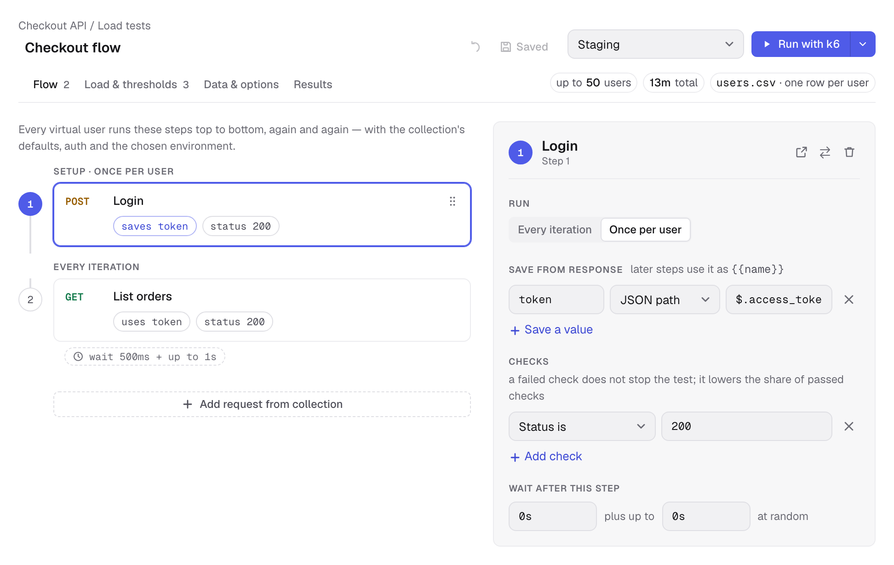

1. Save an HTTP or GraphQL request in a collection.
2. Open its menu and choose **Load test this request**. Kurlo opens a one-step **Smoke** test named *New load test*: two virtual users for one minute. **New load test** in the collection menu starts the flow with every HTTP and GraphQL request in the collection instead, and **New load test from folder** in a folder menu with the requests in that folder and its subfolders; remove the ones you do not need. If the flow is empty, it lists the collection's requests: tick them in the order they should run — each shows its position — or use **Select all**, then click **Add requests to the flow**.
3. Give the test a name and choose its environment. **Active environment** follows the workspace's current selection; choosing a named environment stores that choice with the test.
4. Review **Flow**, **Load & thresholds** and **Data & options**. The **Plan** line under the name sums up the test — steps, peak load, total duration, pass criteria and test data — and each item opens the tab that sets it. When something needs fixing, the field is marked where it is and its tab gets a red dot.
5. Click **Save**. A new test is an **Unsaved draft** — even with autosave on, it reaches the collection and the sidebar only when you save it. The open test has its own tab at the top, so you can switch to requests and come back without losing edits; closing the tab, or opening another load test, asks whether to save a draft you have changed or unsaved changes. A draft you have not touched since it opened closes without asking. Once saved, later edits follow your autosave setting. Saved tests are listed in a collapsible **Load tests** group at the end of their collection; its **+** button starts another test.
6. Choose **Export k6 script**, or install k6 and click **Run with k6**.

A test has one flow. Its steps can use saved HTTP and GraphQL requests from the same collection. Requests remain linked to the collection, so changes to a request are picked up by the next export or run. The collection's defaults, headers, auth and environment variables feed the generated script.

