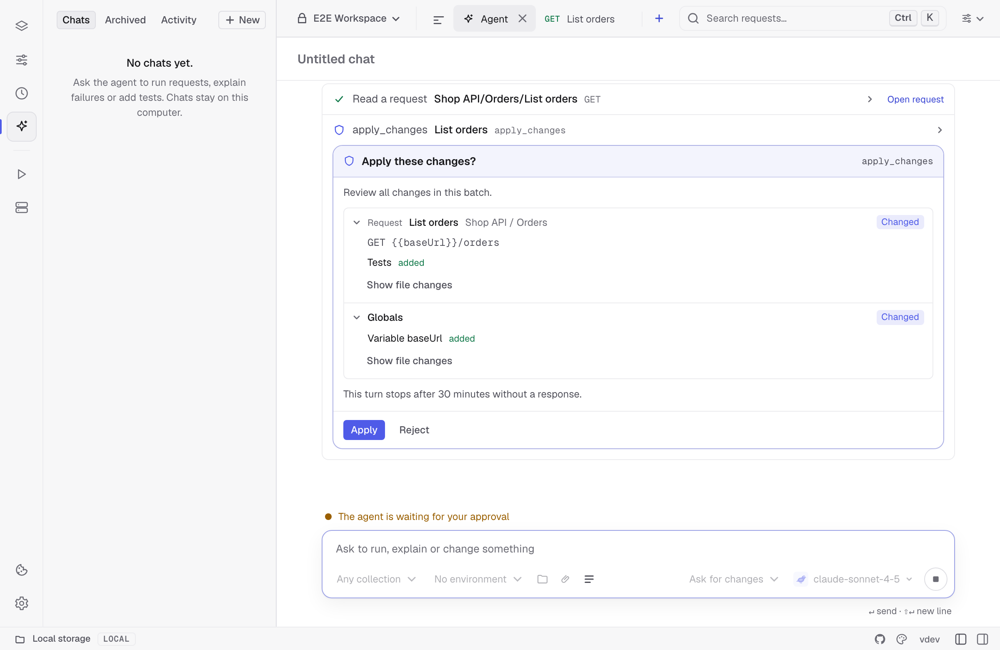

`kurlo mcp` serves a Kurlo workspace to AI assistants as a [Model Context Protocol](https://modelcontextprotocol.io) server. Once it is connected, an assistant can see your collections and environments, run a saved request and read the response, run a collection's tests, or send a one-off call that uses your environment's variables. It does this with the same engine as the app and [`kurlo run`](/docs/guides/cli-runner/).

It can also write to the workspace: add and change saved requests with their tests, write tests from a response, save responses as examples and set environment variables. An agent that adds an endpoint to your service can add the request for it in the same commit, and Kurlo, if it is open, shows the change within a second.

The assistant starts `kurlo mcp` itself and talks to it over stdin and stdout. The server comes from the [`@kurlo/cli`](https://www.npmjs.com/package/@kurlo/cli) npm package, which `npx` downloads on first use, so the commands below work with or without the desktop app installed.

## Connect an assistant

One command adds Kurlo to every AI client it finds on your machine: Claude Code, Claude Desktop, Codex, Cursor, VS Code, Windsurf and Gemini CLI.

```bash
npx -y @kurlo/cli mcp install --env Local
```

It prints what it changed in each client's config and leaves everything else in those files as it was. Run it again after changing the flags and it updates the entries; run `kurlo mcp uninstall` to take them out. Name clients to set up only those, such as `kurlo mcp install cursor codex`, and add `--dry-run` to see the changes first.

| Flag | Meaning |
|------|---------|
| `--env NAME` | Environment the server uses when a call does not name one. |
| `--workspace DIR` | Serve this workspace instead of the one the app has open. |
| `--read-only` | Install the server with only the tools that read and run. |
| `--project` | Write the project's shared config instead of yours. See below. |
| `--command PATH` | How clients start Kurlo: `npx`, or the path to a `kurlo` binary. |
| `--name NAME` | Server name in the clients' config, `kurlo` by default. |
| `--dry-run` | Show what would change, change nothing. |

When the Kurlo app is installed, clients start the server from the app's own binary, even if you ran the command through `npx`: apps opened from the Dock or Start menu often cannot find `npx`. Without the app, they start it with `npx -y @kurlo/cli`. Claude Code is set up with `claude mcp add` when the `claude` command is available, and otherwise in `~/.claude.json`. A config file with comments in it is not changed; Kurlo prints the entry to add by hand instead. Restart Claude Desktop, Windsurf and running Claude Code sessions to pick up the change.

### Share it with your team

Run it with `--project` in a repository that holds a Kurlo workspace, and it writes the project's own config instead: `.mcp.json`, which Claude Code and VS Code read, and `.cursor/mcp.json` when the project uses Cursor. Commit them, and everyone who opens the repository in one of those clients gets the Kurlo server for that workspace.

```bash
npx -y @kurlo/cli mcp install --project --env Local
```

It finds the workspace in the current folder or a folder right inside it, such as `./api-tests`, and records it as a relative path. The entries always start Kurlo with `npx`, so they work on every teammate's machine.

### By hand

**Claude Code**

```bash
claude mcp add kurlo -- npx -y @kurlo/cli mcp --env Local
```

**Codex** (CLI, IDE extension and desktop app share one config)

```bash
codex mcp add kurlo -- npx -y @kurlo/cli mcp --env Local
```

or in `~/.codex/config.toml`:

```toml
[mcp_servers.kurlo]
command = "npx"
args = ["-y", "@kurlo/cli", "mcp", "--env", "Local"]
```

**Claude Desktop, Cursor and other clients with a JSON config** (`claude_desktop_config.json`, `.cursor/mcp.json`, …)

```json
{
  "mcpServers": {
    "kurlo": {
      "command": "npx",
      "args": ["-y", "@kurlo/cli", "mcp", "--env", "Local"]
    }
  }
}
```

### Without Node.js

The desktop app is the same server. Point the client at its binary instead of `npx`: `/Applications/Kurlo.app/Contents/MacOS/kurlo` on macOS, or the installed `kurlo` executable on Linux and Windows.

```bash
claude mcp add kurlo -- /Applications/Kurlo.app/Contents/MacOS/kurlo mcp --env Local
```

With no workspace argument, the server uses the workspace the app has open, including the secret values the app keeps on this machine. To serve a different [Git-backed workspace](/docs/guides/git-workspaces/), pass its folder (the one that contains `kurlo.yml`) as the first argument:

```bash
kurlo mcp ~/code/payments-api/kurlo --env Staging
```

The workspace is read again on every call, so a request you edit in the app is what the assistant runs next. In the other direction, the app notices files the assistant wrote and reloads them. If you were editing at that moment, both changes are kept: see [Working alongside the app](#working-alongside-the-app).

## Tools

| Tool | What it does |
|------|--------------|
| `list_requests` | Lists saved requests with their path (`Collection/Folder/Name`), id, protocol, method and URL. Can be filtered to one collection, and searched with `query`: every word has to appear in the path, method or URL, so `post orders` finds `POST /orders`. |
| `get_request` | Shows how one request is defined: method, URL, query parameters, headers, body, auth type, scripts and browser settings, plus its saved [examples](/docs/guides/examples/) with their status, content type and body, so the assistant can compare a live response with the expected one. Credentials are left out. |
| `list_environments` | Lists environments and their variables. Secret values are hidden. |
| `run_request` | Sends a saved HTTP, GraphQL, unary gRPC, MCP or AI request. HTTP responses include timings, redirects and TLS details. For MCP, pass `mcpMethod` as `tools/list` or `tools/call`. Pass `mcpName` and `mcpArguments` to call a tool, and `mcpCursor` to read another page. |
| `run_collection` | Runs HTTP, GraphQL and unary gRPC requests in order, with per-request results and assertions. Use `iterations`, `delayMs`, `failFast` and a workspace-relative CSV or JSON `dataFile`. A data file runs one iteration per row. Pass a `progressToken` for progress after each request. |
| `send_request` | Sends an unsaved HTTP request. `{{variables}}` in the URL, headers and body are resolved from the environment. |
| `list_history` | Lists the requests you recently sent from the Kurlo app, newest first, with status, timing and the saved request each came from. Can be searched, or narrowed to failures. |
| `get_history_entry` | Shows one request you sent from the app and the response you got: status, headers, body, error, test results and script logs. Without an entry it shows the last one. |
| `diagnose_last_failure` | Explains why a request sent from the app failed. See [When a request fails](#when-a-request-fails). |
| `import_preview`, `import_apply` | Preview imported YAML, then confirm and apply that preview. |
| `list_files`, `read_file`, `search_code` | List, read or search the read-only source folder supplied with `--project-root`. |
| `get_docs`, `save_docs` | Read or replace Markdown docs for a saved request or collection. |
| `code_snippet` | Generate a snippet in cURL, HTTPie, JavaScript, Node.js, Axios, Python, Go, Java, C#, PHP, Ruby, Swift, Kotlin or Rust. |
| `sync_collection`, `cover_endpoint` | Get a workflow for using the connected source folder to update collection coverage. |
| `list_load_tests`, `get_load_test`, `save_load_test` | List, read or save a collection's load tests. Omit the test ID to create a test, or keep it to replace its definition. |
| `start_load_test`, `load_test_status`, `stop_load_test` | Start k6 in the background, inspect progress or stop the active run. |
| `list_load_runs`, `load_test_result`, `compare_load_runs` | Find completed runs and compare their summaries by test ID and `startedAt` timestamp. |
| `start_mock_server`, `mock_server_log`, `stop_mock_server` | Serve a collection's saved examples on localhost, check the recent request log or stop the server. |
| `list_cookies`, `clear_cookie_jar` | Inspect cookie metadata for a domain or clear the jar used by this MCP connection. |
| `create_collection` | Creates an empty collection. |
| `save_request` | Creates or edits any supported request type using workspace YAML. The HTTP and GraphQL shorthand is also available. |
| `patch_request` | Changes individual fields of a saved request with JSON Merge Patch. |
| `list_globals` | Reads globals in the active local profile. Secret values are hidden. |
| `authorize_oauth2` | Authorizes a saved request for the current session. See [OAuth 2.0 sign-in](#oauth-20-sign-in). |
| `apply_changes` | Applies an ordered batch of workspace edits. Agent Mode reviews the combined diff once. |
| `delete_request` | Deletes a saved request and its examples. |
| `save_example` | Saves a response as an [example](/docs/guides/examples/) of a request: the response of the last `run_request` of that request, or one the assistant describes with `status` and `body`. |
| `set_variable` | Sets a non-secret variable in an environment, and creates the environment if there is none with that name. |
| `generate_tests` | Writes a request's status, `Content-Type` and JSON schema tests from a real or described response. See [Tests from a response](#tests-from-a-response). |
| `git_status` | Shows the branch, its upstream, commits ahead and behind, and which workspace files have uncommitted changes. |
| `git_diff` | Shows the uncommitted diff of the workspace files or one file; with `outgoing`, the committed changes not pushed yet. |
| `pull_request_url` | Builds the link that starts a pull request for the current branch on GitHub, or a merge request on GitLab and Bitbucket. |
| `git_create_branch` | Creates a branch from the current commit and switches to it. |
| `git_commit` | Commits uncommitted workspace files, or only the `paths` given, with a `message`. Other files in the repository are never committed. |
| `git_push` | Pushes the current branch to its remote, never with force. The assistant is told to push only when you ask. |

A request can be named by its id, its full path, or just its name when that name is unique. When a name matches more than one request, the tool lists the matches with their ids so the assistant can pick one.

Request and collection runs accept an `environment` and a `variables` object of overrides for that call. `run_request` and `send_request` return up to 64 KB of the response body by default. An assistant can ask for up to 1 MB with `maxBodyBytes`. Binary bodies are described but not included.

Live connection tools are available in the desktop app’s [Agent Mode](/docs/guides/agent/#running-requests-and-tests). A mock or k6 run started through `kurlo mcp` belongs to that process and stops when it exits. The cookie jar is local to the process.

## Import requests and read project source

Start the server with `kurlo mcp /path/to/kurlo-workspace --project-root /path/to/source`. Source paths for `list_files`, `read_file` and `search_code` are relative to the connected folder. The server skips symlinks, hidden configuration, credential files and common dependency and build directories. These tools only read the source. Workspace tools still operate on the Kurlo workspace supplied separately.

Call `import_preview` with a relative `file`, pasted `content` or an OpenAPI `url`. A file path is relative to the source folder when supplied and otherwise to the Kurlo workspace. OpenAPI and Swagger, Postman, Insomnia, HAR and cURL are supported. Format detection is automatic, or you can pass `format` explicitly. For a spec with external references, bundle it into one file before importing.

The preview reports the intended collection, requests and environments and shows the YAML diff. Omit `collection` to create a collection, or supply its name or ID to append requests. Pass `workspace` when the Kurlo folder contains multiple workspaces and you are creating a collection. If the diff spans several pages, call `import_preview` again with the `importId` and `nextOffset` as `offset`. Review the result and pass its `importId` and `confirm: true` to `import_apply`. A file changed since the preview requires a new preview. Agent Mode asks you to approve the diff in the chat.

## Prompts

The server also offers three [prompts](https://modelcontextprotocol.io/specification/2026-07-28/server/prompts): ready-made instructions that clients show as commands. In Claude Code they are `/mcp__kurlo__sync_collection` and so on.

| Prompt | Arguments | What the assistant does |
|--------|-----------|-------------------------|
| `sync_collection` | `collection`, `source` | Finds the HTTP routes in your project's code (Express, FastAPI, Flask, Go routers, Spring, Rails, ASP.NET and others), matches them with the saved requests, and adds a request with tests for each route that has none. It deletes nothing: saved requests that match no route are listed for you to decide. |
| `cover_endpoint` | `endpoint` (required), `collection` | Does the same for one endpoint, such as `POST /orders`, and also saves its main error responses as examples. |
| `debug_last_failure` | `entry` | Calls `diagnose_last_failure`, explains the cause and proposes a fix, which it applies only after you agree. |

Requests are saved with `{{baseUrl}}` in the URL, so the address lives in an environment, not in each request. When no environment sets it, the prompts tell the assistant to look for it in the project (`docker-compose.yml`, launch settings, the README) and to ask you before calling `set_variable`, and never to point an environment at production. With `--read-only` only `debug_last_failure` is offered.

## Tests from a response

`generate_tests` writes a saved request's tests for it. With `from: run`, the default, it sends the request and writes three `pm.test` checks from the response:

- the status, such as `pm.response.to.have.status(200)`;
- the `Content-Type`;
- a JSON schema of the body, checked with `pm.response.to.have.jsonSchema`: the type of every field and which fields are required. Values are left out, so the tests do not break when the next order has another id, and nothing from the response is written into the request's file.

The response is also saved as an [example](/docs/guides/examples/), named after its status, so the [mock server](/docs/guides/mock-server/) serves it. Run `generate_tests` again later and an example of the same name is refreshed rather than added twice.

Sending the request has its effects: a `POST` creates what it creates. A response with a 4xx or 5xx status is refused, since the tests would assert a failure, unless the call passes `allowErrorStatus: true` to test that error on purpose.

When the API is not running anywhere yet, `from: example` takes what the code returns instead: a `status` and a `body`, or a `schema` built from the response type. The tests and the example are written the same way, and the tests pass once the server is up. A schema that does not accept its own body is refused.

Tests the request already has are kept and the new ones are added after them. A test with the same name, such as `status is 200`, is not added twice. When the request's tests already expect another status, an error response such as a `422` is saved as an example only, so the script never asserts two statuses. `replace: true` replaces the whole test script.

## When a request fails

`diagnose_last_failure` takes the most recent request sent from the app that got no response, a 4xx or 5xx status, or failing tests, or the history entry you name, and returns:

- the status, the error and the failed tests;
- `unresolvedVariables`: the `{{variables}}` the request uses that nothing sets in the environment active in the app;
- `example`: how the response differs from the request's saved example, with missing fields, fields that changed type and a different status;
- `hints`: the likely cause in plain words, such as a server that is not running, a host that does not resolve, a `401` because the login request has not set `{{token}}` yet, a method typed into the URL field, or a pre-request script that threw.

It only reads, so it is there with `--read-only` too.

## What you just sent from the app

The assistant can read the requests you send from the Kurlo app, so you can debug together without copying anything: send a request, then ask "why did my last request fail?" `get_history_entry` with no arguments returns the last request sent from the app with its response, test results and script logs, and `list_history` finds older ones, such as every request that failed today.

These tools read the [history](/docs/guides/history/) that Kurlo keeps on this machine, for every workspace, including requests you never saved. Secrets are masked as everywhere else: values Kurlo stores as secrets, auth credentials and the values of headers like `Authorization` and `Cookie` come back as `[secret]`. Both tools only read, so they are also there with `--read-only`.

## Writing to the workspace

The write tools change the same YAML files the app writes, through the same code, so the result looks exactly as if you had made it in the app. In a [Git-backed workspace](/docs/guides/git-workspaces/) every change shows up in Git, and a deletion can be undone from history. Each result names the file it wrote.

For the HTTP and GraphQL shorthand, `save_request` without `request` creates a request. It needs a `url`, and a `collection` unless the workspace has only one. With `request`, the id or path of an existing one, it changes only the fields the call passes. `params`, `headers` and `form` replace the whole list. `folder` puts the request in a folder, creating it if needed, and `collection` moves it to another collection. The other fields are:

| Field | Meaning |
|-------|---------|
| `name` | Defaults to the method and path, such as `POST /orders`. |
| `type` | `http` (the default) or `graphql`. |
| `method`, `url` | `url` may use `{{variables}}`, such as `{{baseUrl}}/orders`, and `:name` path variables, such as `/orders/:orderId`. |
| `pathVariables` | Values for the URL's `:name` segments, such as `[{"key": "orderId", "value": "{{orderId}}"}]`. Replaces the whole list. `get_request` returns them under the same name. |
| `body`, `bodyType` | A JSON body is stored as JSON and anything else as text, unless `bodyType` says `xml`, `html`, `urlencoded`, `form` or `none`. |
| `query`, `variables` | The query and variables of a GraphQL request. |
| `auth` | `inherit` (the default, the collection's auth), `none`, `bearer` with `token`, `basic` with `username` and `password`, or `apikey` with `key`, `value` and `in`. |
| `preRequestScript`, `testScript` | JavaScript with the [Postman `pm.*` API](/docs/reference/scripting-api/). `pm.test` calls in `testScript` become the request's tests, which `run_request` and `run_collection` report. |
| `assertions` | [Checks without code](/docs/guides/scripting/#assertions), such as `[{"target": "status", "operator": "eq", "value": "201"}]`. Operators: `eq`, `neq`, `gt`, `gte`, `lt`, `lte`, `in`, `notIn`, `contains`, `notContains`, `matches`, `exists`, `notExists`, `type`, `length`. Replaces the whole list; `[]` removes them. `get_request` returns them, and `run_request` reports them with the tests. |
| `notes` | Notes shown with the request. |

### Workspace YAML and partial edits

Pass the `yaml` argument to `save_request` for HTTP (including SSE), GraphQL, WebSocket, Socket.IO, gRPC, MCP or AI requests. Use a single `version: 1` document with a `request` mapping and the fields in the [workspace format](/docs/reference/kurlo-yaml-format/#request-file). Kurlo can assign the request ID. Pass `collection` to choose the target collection or use `collectionId` in the document. Use `request` to edit an existing request. Call `get_request` with `format: "yaml"` to inspect its workspace fields, including protocol-specific settings. The output omits stored credentials.

Pass `request` and a `patch` object to `patch_request`. It merges nested objects, replaces arrays and removes fields set to `null`. For example, `{"request":"Orders/List orders","patch":{"requestNotes":"Returns recent orders"}}` changes only the notes. Use the workspace field names for authentication, client certificate settings and scripts. NTLM uses `auth.type: ntlm`, `basicUser` and `basicPass`.

### Batch edits

Pass an `operations` array to `apply_changes`. Each entry has a `tool` name and an `arguments` object. Operations run in order, so an edit can refer to a request created earlier in the batch. If validation fails, Kurlo saves none of the edits. In Agent Mode, all affected files appear in one review with one **Apply** button.



The results from `run_request` and `run_collection` include the logs from collection, folder and request scripts.

| Operation | Arguments |
|-----------|-----------|
| `create_collection`, `save_request`, `patch_request`, `delete_request`, `save_example`, `set_variable` | Same arguments as the standalone tools. |
| `duplicate_request` | `request` and an optional `patch` for the copy. |
| `patch_collection` | `collection` and `patch` for the name, description, defaults, folder paths or folder defaults. Set scripts and authentication in `defaults` or `folderDefaults`. |
| `move_folder`, `duplicate_folder` | `collection`, `from` and `to` as slash-separated folder paths, and optional `targetCollection`. Includes nested requests and folder defaults. |
| `duplicate_collection` | `collection` and optional `name`. Copies requests, examples and defaults. |
| `create_environment`, `patch_environment`, `delete_environment` | Create with `name` and optional `workspace` and `patch`. Update with `environment` and `patch` for `name`, `parentId` or `values`; `values` replaces the whole list. `values` (or `variables`) is a list of `{key, value}` rows with optional `description` and `enabled`, or an object such as `{"baseUrl": "https://api.example.com"}`, so one batch can create many environments with their variables. Rows marked `secret` are refused: add secrets in the app. Delete with `environment`. |
| `patch_example`, `delete_example` | `request` and `example` by name or ID. Pass a `patch` object to edit the example. |
| `edit_global` | `key` and `value` to create or update, `name` to rename, or `delete: true` to remove. Open the workspace in Kurlo first. |

Globals stay in the encrypted local profile. Agent Mode shows global edits alongside workspace files in the same review. Set secret globals in Kurlo.

### OAuth 2.0 sign-in

Call `authorize_oauth2` with a saved request ID or path and, if needed, its environment. For Authorization Code and Device Code, approve the call and finish sign-in in your browser. An external MCP client needs to request progress notifications to receive the URL or device code. Client Credentials and Password use the saved configuration directly. Tokens stay in memory for the current Agent Mode turn or external MCP connection and stay out of tool results.

### Secrets stay out

The write tools never put a secret in a file. A bearer token, password or API key value has to be a variable reference such as `{{apiToken}}`, and a literal value is refused. Add the value in the app as a variable marked secret, and the request uses it. Existing secrets are masked on reads. Omit fields containing saved secrets from a patch to preserve them. The YAML and patch tools accept normal variable references in authentication fields and refuse internal vault placeholders.

### Read-only

Start the server with `--read-only` to offer only the tools that read and run. The write tools, `git_create_branch`, `git_commit` and `git_push` are then left out of the tool list, and calling one is refused.

## Protected environments

Mark an environment **Protect from AI agents** in its ⋯ menu in the app, and `kurlo mcp` refuses every call that would use it: `run_request`, `run_collection`, `send_request` and `start_load_test` with that environment, and edits to it through `set_variable` or `apply_changes`. The assistant is told to ask you to run the request in the app instead. Use it for production and anything else an assistant should not reach by picking the wrong environment.

The mark is saved in the environment's file as `protected: true`, so in a Git-backed workspace it applies to everyone on the team. `list_environments` shows it. An environment that [inherits](/docs/guides/environments/#inheriting-from-another-environment) from a protected one is protected too; `list_environments` names its parent under `inherits` and lists the variables it inherits.

## Working alongside the app

The app and `kurlo mcp` can have the same workspace open. They take turns writing it, so neither reads the other's half-written save. The app checks for files changed outside it about once a second and reloads them, with a short notice. If the app saves before it has reloaded, for example because you were typing in a request at that moment, it writes your edits and then puts back every file changed outside it that your edits did not touch. Only when both changed the same file does the app's version win.

The same protection covers files changed by an editor or by `git pull` in a terminal.

## Checking a call the way a browser would

An API call that works from the assistant can still be refused in the browser, where CORS applies. `run_request` and `send_request` take `browserOrigin`, the origin of the page that would make the call, such as `https://app.example.com`. Kurlo then sends it with [browser emulation](/docs/guides/browser-security/): browser headers and `Origin`, the CORS preflight when the method or headers need one, and the CORS error a browser would raise, in the result's `error`. Add `browserCredentials: true` for a call made with `credentials: 'include'`, which a wildcard `Access-Control-Allow-Origin` does not satisfy.

A saved request that already has browser emulation turned on, by itself or through its collection, is sent with those settings even without `browserOrigin`.

## Variables carry across calls

A value a script sets with `pm.environment.set` or `pm.collectionVariables.set` is kept for the rest of the session, per environment. An assistant can run your login request once, and the token it stores is used by every request after it, just as in a collection run. Each result lists the variables the call changed in `variablesChanged`. These values live only in the server's memory. They are not written back to the workspace, and they are gone when the assistant restarts the server.

When a request uses a `{{variable}}` that no environment, call override or script has set, the result lists it in `unresolvedVariables`. The request is still sent with the placeholder as written, so a `401` next to `unresolvedVariables: ["token"]` tells the assistant to run the login request first or pass the value in `variables`.

Cookies and OAuth 2.0 tokens are kept for the session too. OAuth works the same way as [in `kurlo run`](/docs/guides/cli-runner/#oauth-20-in-ci): Client Credentials and Password grants are fetched, and browser grants use their refresh token.

## Secrets

Environment variables marked secret are used when requests are sent, but they are masked as `[secret]` in everything returned to the assistant. That covers the resolved URL, response headers and body, test messages and script logs. A server that echoes your token back does not hand it to the model. `list_environments` shows only the names of secret variables, and `get_request` never includes credentials. The write tools never store a secret either: see [Secrets stay out](#secrets-stay-out).

## Flags

| Flag | Meaning |
|------|---------|
| `--env NAME` | Environment used when a call does not name one. |
| `--timeout MS` | Per-request timeout, overriding request settings. |
| `--insecure`, `-k` | Turn off TLS certificate verification for every request. |
| `--allow-send-request` | Let scripts call `pm.sendRequest`. Off by default, as in `kurlo run`. |
| `--project-root <path>` | Connect a read-only source folder for project tools and file imports. |
| `--read-only` | Offer only the tools that read and run. |

## Docs for agents

The whole Kurlo documentation is available in plain text for language models: [llms.txt](https://kurlo.dev/llms.txt) lists the pages, and [llms-full.txt](https://kurlo.dev/llms-full.txt) has all of them in one file.

## Protocol

The server speaks MCP over stdio with newline-delimited JSON-RPC. It supports the `initialize` handshake of the 2024-11-05 through 2025-11-25 revisions, and the stateless 2026-07-28 revision's `server/discover`. It offers tools and prompts, and no resources. Tool results carry the JSON as text and as `structuredContent`. A call can be cancelled with `notifications/cancelled`.

To try the server by hand, pipe JSON-RPC into it:

```bash
printf '%s\n' '{"jsonrpc":"2.0","id":1,"method":"tools/call","params":{"name":"list_requests","arguments":{}}}' | kurlo mcp
```
