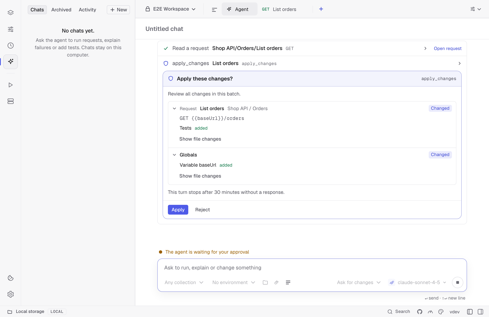

The write tools change the same YAML files the app writes, through the same code, so the result looks exactly as if you had made it in the app. In a [Git-backed workspace](/docs/guides/git-workspaces/) every change shows up in Git, and a deletion can be undone from history. Each result names the file it wrote.

For the HTTP and GraphQL shorthand, `save_request` without `request` creates a request. It needs a `url`, and a `collection` unless the workspace has only one. With `request`, the id or path of an existing one, it changes only the fields the call passes. `params`, `headers` and `form` replace the whole list. `folder` puts the request in a folder, creating it if needed, and `collection` moves it to another collection. The other fields are:

| Field | Meaning |
|-------|---------|
| `name` | Defaults to the method and path, such as `POST /orders`. |
| `type` | `http` (the default) or `graphql`. |
| `method`, `url` | `url` may use `{{variables}}`, such as `{{baseUrl}}/orders`, and `:name` path variables, such as `/orders/:orderId`. |
| `pathVariables` | Values for the URL's `:name` segments, such as `[{"key": "orderId", "value": "{{orderId}}"}]`. Replaces the whole list. `get_request` returns them under the same name. |
| `body`, `bodyType` | A JSON body is stored as JSON and anything else as text, unless `bodyType` says `xml`, `html`, `urlencoded`, `form` or `none`. |
| `query`, `variables` | The query and variables of a GraphQL request. |
| `auth` | `inherit` (the default, the collection's auth), `none`, `bearer` with `token`, `basic` with `username` and `password`, or `apikey` with `key`, `value` and `in`. |
| `preRequestScript`, `testScript` | JavaScript with the [Postman `pm.*` API](/docs/reference/scripting-api/). `pm.test` calls in `testScript` become the request's tests, which `run_request` and `run_collection` report. |
| `assertions` | [Checks without code](/docs/guides/scripting/assertions/), such as `[{"target": "status", "operator": "eq", "value": "201"}]`. Operators: `eq`, `neq`, `gt`, `gte`, `lt`, `lte`, `in`, `notIn`, `contains`, `notContains`, `matches`, `exists`, `notExists`, `type`, `length`. Replaces the whole list; `[]` removes them. `get_request` returns them, and `run_request` reports them with the tests. |
| `notes` | Notes shown with the request. |

## Workspace YAML and partial edits

Pass the `yaml` argument to `save_request` for HTTP (including SSE), GraphQL, WebSocket, Socket.IO, gRPC, MCP or AI requests. Use a single `version: 1` document with a `request` mapping and the fields in the [workspace format](/docs/reference/kurlo-yaml-format/request/). Kurlo can assign the request ID. Pass `collection` to choose the target collection or use `collectionId` in the document. Use `request` to edit an existing request. Call `get_request` with `format: "yaml"` to inspect its workspace fields, including protocol-specific settings. The output omits stored credentials.

Pass `request` and a `patch` object to `patch_request`. It merges nested objects, replaces arrays and removes fields set to `null`. For example, `{"request":"Orders/List orders","patch":{"requestNotes":"Returns recent orders"}}` changes only the notes. Use the workspace field names for authentication, client certificate settings and scripts. NTLM uses `auth.type: ntlm`, `basicUser` and `basicPass`.

## Batch edits

Pass an `operations` array to `apply_changes`. Each entry has a `tool` name and an `arguments` object. Operations run in order, so an edit can refer to a request created earlier in the batch. If validation fails, Kurlo saves none of the edits. In Agent Mode, all affected files appear in one review with one **Apply** button.

The results from `run_request` and `run_collection` include the logs from collection, folder and request scripts.

| Operation | Arguments |
|-----------|-----------|
| `create_collection`, `save_request`, `patch_request`, `delete_request`, `save_example`, `set_variable` | Same arguments as the standalone tools. |
| `duplicate_request` | `request` and an optional `patch` for the copy. |
| `patch_collection` | `collection` and `patch` for the name, description, defaults, folder paths or folder defaults. Set scripts and authentication in `defaults` or `folderDefaults`. |
| `move_folder`, `duplicate_folder` | `collection`, `from` and `to` as slash-separated folder paths, and optional `targetCollection`. Includes nested requests and folder defaults. |
| `duplicate_collection` | `collection` and optional `name`. Copies requests, examples and defaults. |
| `create_environment`, `patch_environment`, `delete_environment` | Create with `name` and optional `workspace` and `patch`. Update with `environment` and `patch` for `name`, `parentId` or `values`; `values` replaces the whole list. `values` (or `variables`) is a list of `{key, value}` rows with optional `description` and `enabled`, or an object such as `{"baseUrl": "https://api.example.com"}`, so one batch can create many environments with their variables. Rows marked `secret` or linked to a secret manager are refused, and so is an environment that already has them: add secrets and links in the app. Delete with `environment`. |
| `patch_example`, `delete_example` | `request` and `example` by name or ID. Pass a `patch` object to edit the example. |
| `edit_global` | `key` and `value` to create or update, `name` to rename, or `delete: true` to remove. Open the workspace in Kurlo first. |

Globals stay in the encrypted local profile. Agent Mode shows global edits alongside workspace files in the same review. Set secret globals in Kurlo.

## OAuth 2.0 sign-in

Call `authorize_oauth2` with a saved request ID or path and, if needed, its environment. For Authorization Code and Device Code, approve the call and finish sign-in in your browser. An external MCP client needs to request progress notifications to receive the URL or device code. Client Credentials and Password use the saved configuration directly. Tokens stay in memory for the current Agent Mode turn or external MCP connection and stay out of tool results.

## Secrets stay out

The write tools never put a secret in a file. A bearer token, password or API key value has to be a variable reference such as `{{apiToken}}`, and a literal value is refused. Add the value in the app as a variable marked secret, and the request uses it. Existing secrets are masked on reads. Omit fields containing saved secrets from a patch to preserve them. The YAML and patch tools accept normal variable references in authentication fields and refuse internal vault placeholders.
