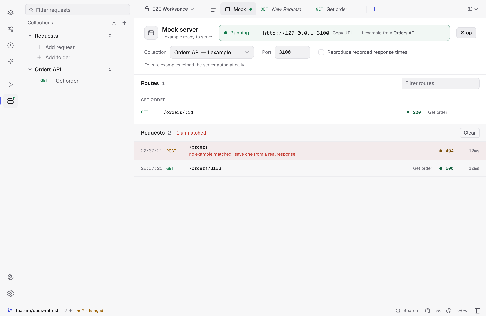

## Starting it

Open the **Mock** tab from the server icon in the activity rail on the left, pick a collection, and press **Start server** at the top right. The status bar beside it shows whether the server runs and its base URL; click the URL to copy it. **Close tab** (`Cmd+W`, or `Ctrl+W` on Windows and Linux) closes the Mock tab like any other tab; a running server keeps running:

```
http://127.0.0.1:3100
```

Point your client at that instead of the real API and every request matching an example gets the recorded response back.



The **Start** button stays disabled until the selected collection has at least one example — there would be nothing to serve.
