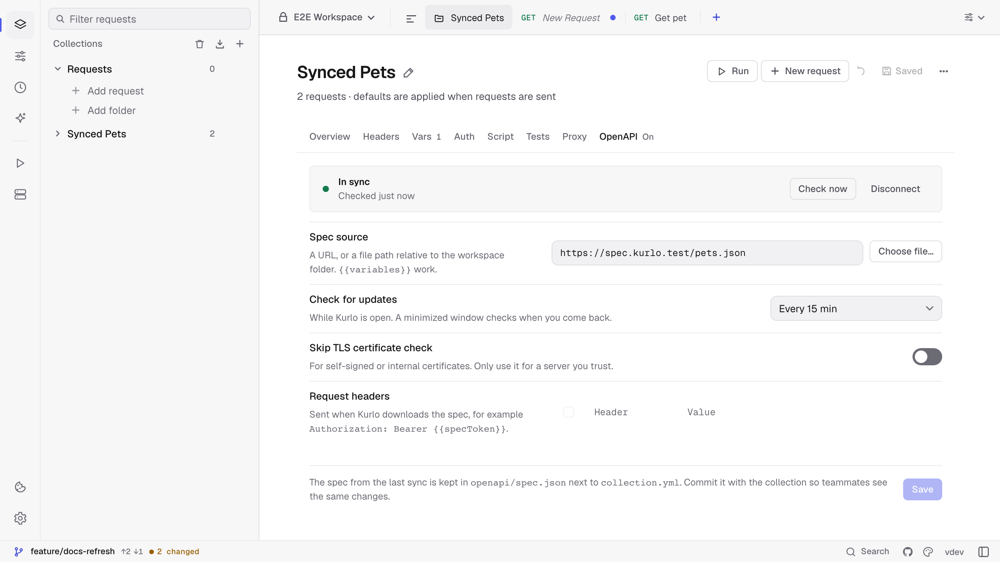
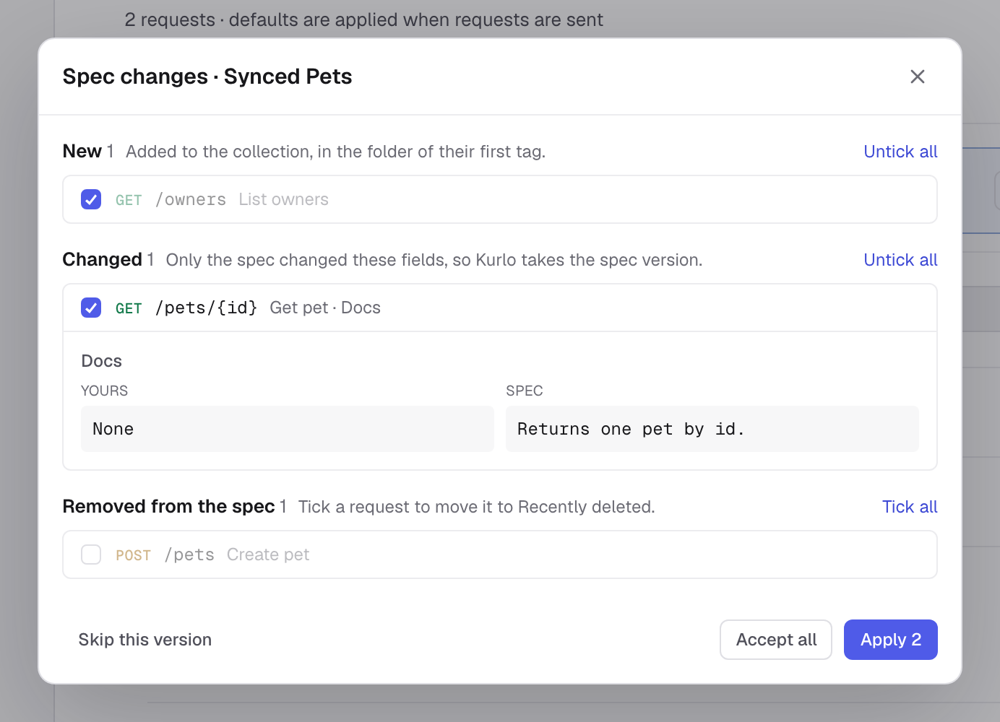

A collection imported from an OpenAPI spec goes stale as soon as the API changes. OpenAPI sync keeps a link to the spec and shows you what changed: new endpoints, changed parameters, bodies and docs, and endpoints that are gone. Nothing changes until you review it, and your own edits, scripts and tests stay yours. There is no limit on how often you sync.

## Connecting a collection

There are two ways in:

- **When you import.** **Import collection → OpenAPI / Swagger from URL** has **Keep in sync with this URL** ticked by default. The new collection is linked to that URL straight away.
- **For an existing collection.** Open the collection's **•••** menu and choose **OpenAPI sync…**, or open its settings and the **OpenAPI** tab. Enter the spec's URL, or a file path relative to the workspace folder, such as `../api/openapi.yaml` in a monorepo, and click **Connect**. **Choose file…** picks a file.

The source and its request headers can use `{{variables}}` from the collection and the active environment, for example `https://{{host}}/v3/api-docs` with `Authorization: Bearer {{specToken}}`. Keep tokens in a secret variable rather than in the header itself, because the source settings are saved in `collection.yml`. **Skip TLS certificate check** is there for specs served with a self-signed or internal certificate.

When you connect a collection that was imported earlier, requests are matched to operations by method and path. `{{baseUrl}}` and the host are ignored, and `:id`, `{id}` and `{{id}}` count as the same parameter. Requests that match nothing are left alone.

## Checking for changes

The **OpenAPI** tab shows whether the collection is in sync and when the spec was last checked. **Check now** downloads the spec and opens the review when something changed.

Kurlo also checks on its own while the app is open, every 15 minutes by default. Change it with **Check for updates**: off, every 5 or 15 minutes, every hour, every 6 hours or once a day. A minimized window does not check; the check runs when you come back. Kurlo sends `If-None-Match` and `If-Modified-Since`, so a server that supports them answers `304 Not Modified` and nothing is downloaded or compared. When an automatic check finds changes, a dot appears next to the collection in the sidebar and a short message says what changed. Click the dot to open the tab.

## Reviewing changes

The review groups the changes:

| Group | What it means | Ticked by default |
|-------|---------------|-------------------|
| **New** | Operations added to the spec. They are added to the folder of their first tag. | Yes |
| **Changed** | Only the spec changed these fields, so Kurlo takes the spec's version. | Yes |
| **Conflicts** | You and the spec both changed the same field. **Keep mine** or **Use spec** per endpoint. | Yes, keeping yours |
| **Removed from the spec** | Requests whose operation is gone. Ticked ones go to **Recently deleted**. | No |
| **Collection settings** | The `baseUrl` server variable or the collection's auth scheme changed. | Yes |

Click a row to see each field side by side: yours and the spec's. **Apply** applies the ticked rows, **Accept all** applies every row and takes the spec's side in conflicts, and **Skip this version** hides the change until the spec changes again.

A new endpoint you leave unticked is remembered in the collection's `ignored` list and not offered again. An endpoint whose request you deleted yourself is not offered again either.

## What sync compares

For each request linked to an operation, sync compares the method and URL, query parameters, path parameters, headers, the body, the auth type, the Docs tab and the examples that came from the spec. It never touches pre-request and test scripts, assertions, request settings, request variables or examples you saved yourself.

The comparison is three-way. Kurlo keeps the spec from the last applied sync and compares both your request and the new spec with it:

- Only the spec changed a field: the spec's version is taken.
- Only you changed it: yours stays.
- Both changed it: it is a conflict, and yours stays unless you pick the spec.

Parameters and headers are compared row by row. A new row from the spec is added, a row the spec dropped is removed unless you changed its value, and rows you added yourself stay. A value you replaced with a `{{variable}}` is your change and is kept. The body is compared as a whole.

When an operation moves to a new path but keeps its `operationId`, sync treats it as a URL change of the same request rather than a removed and a new endpoint, so the request keeps its scripts and tests.

The first sync of a collection has no earlier spec to compare against. Every difference between your requests and the spec is then shown as a conflict, with your version kept by default.

## Files and teams

The spec from the last applied sync is saved as `openapi/spec.json` next to `collection.yml`, and each linked request stores its operation as `openapi: GET /users/{id}`. Commit both with the collection: a teammate who pulls then sees the same changes you would, instead of every request looking edited. The fields are listed in the [YAML format reference](/docs/reference/kurlo-yaml-format/#openapi-source).

The last check time, the `ETag` and a skipped version are kept on your computer only.

**Disconnect** removes the source and `openapi/spec.json`. Requests keep their `openapi` links, so connecting the same spec again matches them at once.

## In CI and for agents

`kurlo openapi check` compares the current spec with `openapi/spec.json` and exits with `1` when the spec has moved on, so a pipeline can flag drift. See [Contract drift](/docs/guides/cli-runner/#contract-drift-with-kurlo-openapi-check). The `check_openapi_sync` tool of [`kurlo mcp`](/docs/guides/mcp-server/) gives an assistant the same report.

## Limits

- Only HTTP requests take part. GraphQL, gRPC, WebSocket and other request types in the collection are left alone.
- Request names and folders are set when an endpoint is added and are not changed by later syncs.
- Changes are always reviewed; there is no option yet to apply them without the review.
