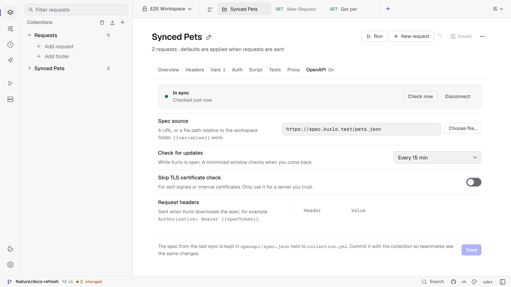

## Connecting a collection

There are two ways in:

- **When you import.** **Import collection → OpenAPI / Swagger from URL** has **Keep in sync with this URL** ticked by default. The new collection is linked to that URL straight away.
- **For an existing collection.** Open the collection's **•••** menu and choose **OpenAPI sync…**, or open its settings and the **OpenAPI** tab. Enter the spec's URL, or a file path relative to the workspace folder, such as `../api/openapi.yaml` in a monorepo, and click **Connect**. **Choose file…** picks a file.

The source and its request headers can use `{{variables}}` from the collection and the active environment, for example `https://{{host}}/v3/api-docs` with `Authorization: Bearer {{specToken}}`. Keep tokens in a secret variable rather than in the header itself, because the source settings are saved in `collection.yml`. **Skip TLS certificate check** is there for specs served with a self-signed or internal certificate.

When you connect a collection that was imported earlier, requests are matched to operations by method and path. `{{baseUrl}}` and the host are ignored, and `:id`, `{id}` and `{{id}}` count as the same parameter. Requests that match nothing are left alone.

## Checking for changes

The **OpenAPI** tab shows whether the collection is in sync and when the spec was last checked. Click **Check now** to check the spec. When Kurlo already knows about pending updates, the button reads **Review changes**.

Kurlo also checks on its own while the app is open, every 15 minutes by default. Change it with **Check for updates**: off, every 5 or 15 minutes, every hour, every 6 hours or once a day. A minimized window does not check; the check runs when you come back. Kurlo sends `If-None-Match` and `If-Modified-Since`, so a server that supports them answers `304 Not Modified` and nothing is downloaded or compared. When an automatic check finds changes, a dot appears next to the collection in the sidebar and a short message says what changed. Click the dot to open the tab.
