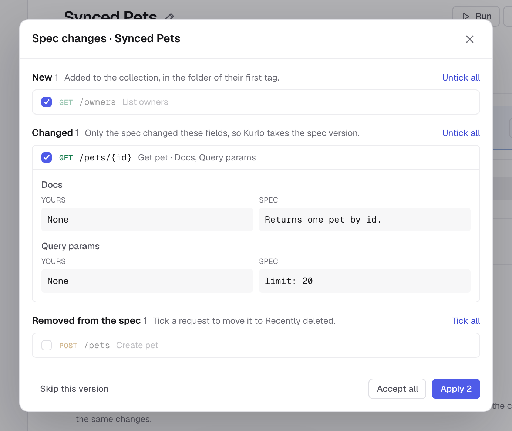

## Reviewing changes

The review groups the changes:

| Group | What it means | Ticked by default |
|-------|---------------|-------------------|
| **New** | Operations added to the spec. They are added to the folder of their first tag. | Yes |
| **Changed** | Only the spec changed these fields, so Kurlo takes the spec's version. | Yes |
| **Conflicts** | You and the spec both changed the same field. **Keep mine** or **Use spec** per endpoint. | Yes, keeping yours |
| **Removed from the spec** | Requests whose operation is gone. Ticked ones go to **Recently deleted**. | No |
| **Collection settings** | The `baseUrl` server variable or the collection's auth scheme changed. | Yes |

Click a row to see each field side by side: yours and the spec's. **Apply** applies the ticked rows, **Accept all** applies every row and takes the spec's side in conflicts, and **Skip this version** hides the change until the spec changes again.

A new endpoint you leave unticked is remembered in the collection's `ignored` list and not offered again. An endpoint whose request you deleted yourself is not offered again either.
