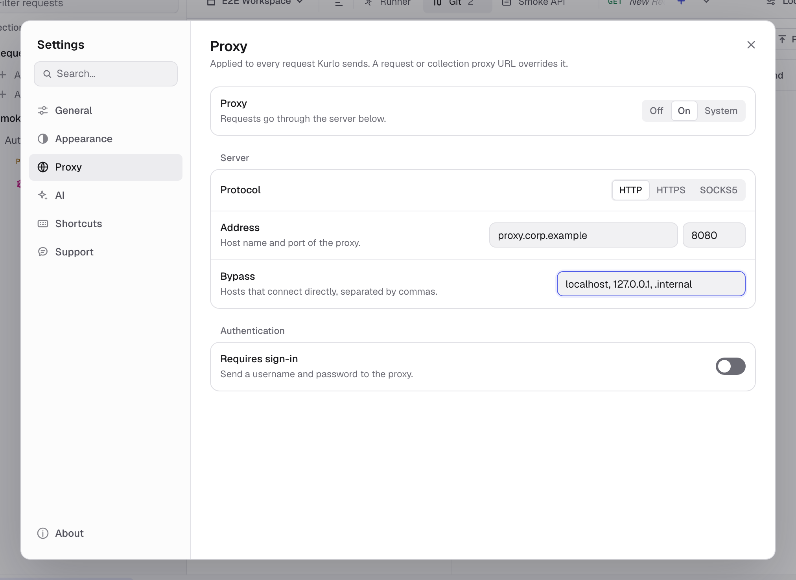

## Precedence

Kurlo resolves proxy configuration in this order:

1. A non-empty proxy URL explicitly set on the request.
2. A collection proxy URL inherited by a request that has not overridden that setting.
3. The app-wide proxy under **Settings -> Proxy**.

Clearing the proxy field on a request marks that field as a request override. The request then skips the collection proxy and falls back to the app-wide setting. Click **Reset** in the request Settings tab to clear its override markers and inherit collection defaults again.

:::note
Kurlo does not have a `direct://` per-request value. To connect directly, remove request and collection proxy URLs and set the global mode to **Off**.
:::

## Global modes

Open **Settings -> Proxy** and choose:

| Mode | Behavior |
|------|----------|
| **Off** | Connect directly. Environment proxy variables are ignored. |
| **On** | Use the custom HTTP, HTTPS, or SOCKS5 proxy configured below. |
| **System** | Use the standard `HTTP_PROXY`, `HTTPS_PROXY`, and `NO_PROXY` environment behavior. |

When **On** is selected, Kurlo requires a hostname. If it is blank, requests fail instead of silently going direct.

For a custom proxy, configure:

- **Protocol**: HTTP, HTTPS, or SOCKS5.
- **Hostname**: without a URL scheme.
- **Port**: `0` uses the protocol's normal URL behavior; SOCKS5 defaults to `1080`.
- **Auth**: optional username and password.
- **Proxy Bypass**: hosts that must connect directly.

The global proxy password is kept only in the running app. Kurlo deliberately removes it from persisted preferences and all-data backups, so you must enter it again after restarting Kurlo or restoring a backup.
