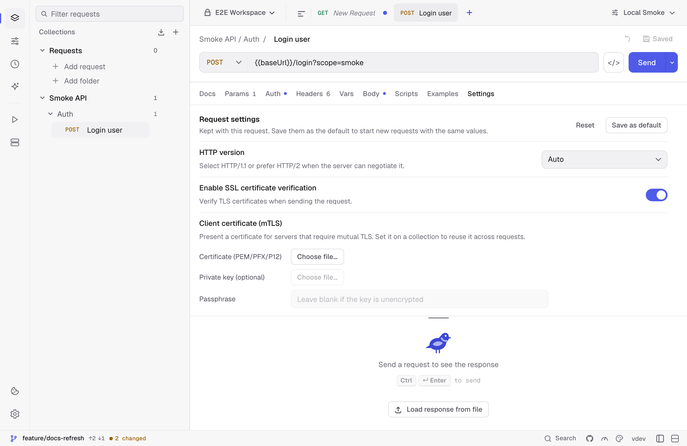

import DocsTopicIndex from "../../../../components/DocsTopicIndex.astro";

Open the request's **Settings** tab to override its defaults. The available options depend on the request type.

Every setting on this page is **per-request** — changing it on `Get user` doesn't affect `Get billing`. Settings travel with the request when you export, duplicate, or commit it to Git.

App-wide preferences (autosave, theme, shortcuts, updates) live in a separate Settings modal opened from the gear at the bottom of the activity rail. See [App settings](/docs/guides/settings/) for that surface.

<DocsTopicIndex />
