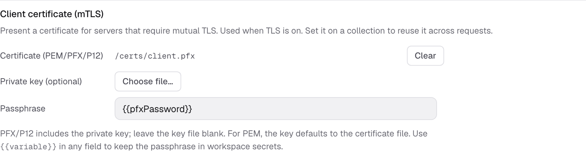

## Client certificate (mutual TLS)

For servers that require **mutual TLS**, open **Settings → Client certificate (mTLS)** on an HTTP, SSE, MCP, or gRPC request. A gRPC call sends the certificate when it uses TLS. For GraphQL requests, set the certificate at collection level.

- **Certificate (PEM/PFX/P12)** — a PEM certificate or a PKCS#12 container (`.pfx` or `.p12`). A PKCS#12 container includes the private key and can include the certificate chain.
- **Private key (optional)** — a separate PEM key file. Leave it blank for PFX/P12 or when the key is in the same file as the certificate (a combined PEM).
- **Passphrase** — the PFX/P12 container password or the password for an encrypted PEM key. It accepts a `{{variable}}`, so you can point it at a workspace secret instead of storing it in the YAML.

After replacing a certificate or key file, send the request again to use the updated certificate. You do not need to restart Kurlo.

To share a certificate, open the collection's **⋯ → Settings** in the sidebar. Select the **Proxy** tab and set **Client certificate (mTLS)**. For manual saving, click **Save** after editing the request or collection settings.

A missing file, a mismatched certificate/key pair, or a wrong passphrase fails the request before it dials, with a message that says which. Kurlo supports password-protected and unprotected PFX/P12 containers, and PEM keys including the legacy openssl encrypted format; PKCS#8-encrypted keys need converting first (`openssl pkcs8 -in key.pem -out key.dec.pem`).
