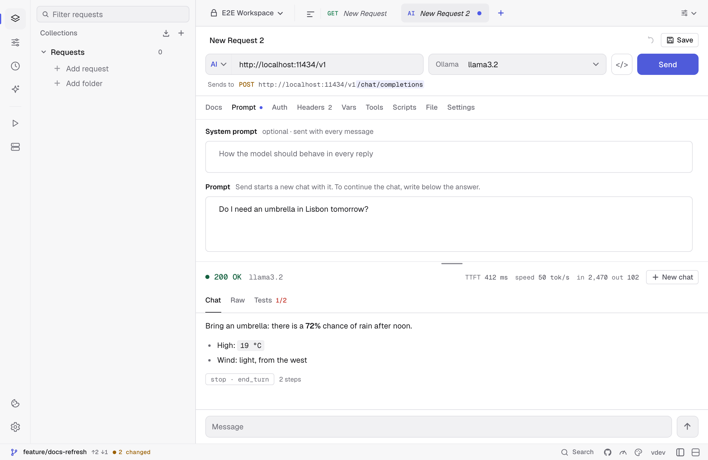
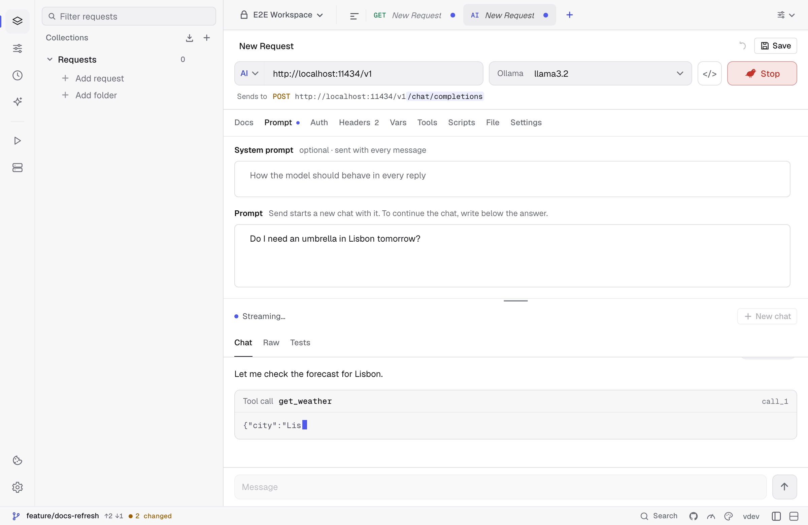

## AI

An AI request sends a prompt to a language model and shows the answer as a conversation. Pick the provider and the model in the box next to the URL: **OpenAI**, **Anthropic**, **OpenRouter**, **Groq**, **Ollama**, **LM Studio**, or **Custom URL** for anything else that speaks the OpenAI Chat Completions API, such as vLLM or your own gateway. The provider fills in the base URL and the auth: a bearer token from `{{openaiApiKey}}`, `{{openrouterApiKey}}` or `{{groqApiKey}}`, `x-api-key` from `{{anthropicApiKey}}`, and no auth for the local servers. Set the key in an environment, mark it secret, and it never lands in the YAML; if the variable is not set, Kurlo says so before sending. A key typed into the Auth tab is kept encrypted on this computer, so a workspace opened on another computer asks for it again. The URL is the provider's base URL: Kurlo adds `/chat/completions` to it, or `/messages` for Anthropic, and shows the full address under the URL field, with the added path highlighted. A URL that already ends with that path is used as it is, and a query string such as `?api-version=` stays at the end. The model is the name the provider knows it by, such as `gpt-4o-mini` or `llama3.2`: when you open the box, Kurlo reads the provider's `/models` list so you can pick one, and you can always type a name instead.

**Kurlo connection** uses the default connection from [Settings → AI](/docs/guides/settings/ai/#ai) instead of a URL and an Auth tab: Kurlo adds the connection's address and key when it sends, so the key never reaches the request, its history or the YAML. The model is the one chosen for that connection, so the request bar shows the connection and its model instead of a model field; change either in Settings → AI and open requests follow at once. **Open Settings → AI** in the model box, or a click on the connection in the request bar, opens Settings → AI on the **Kurlo agent** part with the connections and their models. The Auth tab is not sent. Saved in a shared collection, the request uses each teammate's own default connection. To use another connection than the default, choose it in **Settings → Connection**; the request file keeps only the connection's id, and a teammate without that connection sees **Removed connection** and can pick one of their own.

The **Prompt** tab holds the system prompt and the prompt; `{{variables}}` work in both. The prompt field grows with its text and scrolls once it fills the tab; in a short request panel it shrinks to the space left and shows a scroll bar only when the text does not fit. The prompt and every chat message take up to 200,000 characters (about 50,000 tokens) and the system prompt up to 50,000; a counter shows up next to the label as you get close. **Settings** holds the model parameters (temperature, max tokens, top P, streaming, thinking for Anthropic models), how long to wait for a silent provider, and the SSL and proxy settings a local model or a company proxy may need. Auth and Headers are the usual ones: the provider presets fill Auth in, and Headers is there for gateways that want extra ones, such as OpenRouter's `HTTP-Referer`.



**Send** starts a new conversation with the saved prompt, so the request behaves the same every time you open it. The answer streams in as it is written:

- **Text** builds up word by word, and **thinking** sits in a collapsed block above it when the model shares it.
- **Tool calls** are cards with the tool's name, the server it came from, its call ID and its arguments, which grow while the model writes them. The result, or the tool's error, appears under the call.
- The status line shows the **time to the first token**, the **speed** in tokens per second and the **tokens** in and out, with cache reads; hover it for the breakdown per type.
- The **stop reason** is shown under the answer. An answer cut off by the token limit says so and offers to raise the limit and send again, and an error in the middle of a stream, which arrives with HTTP 200, is shown where the stream stopped, below the part that did arrive.



Answers are rendered as Markdown: headings, lists, tables, code blocks with a **Copy** button, and links, which open in your browser. Images the model puts in its answer as a `data:` URL are shown; remote images stay links, so an answer cannot make Kurlo fetch a URL on its own.

To continue the conversation, type in the field under the answer and press `Enter`; `Shift+Enter` starts a new line. Kurlo sends the earlier messages, the tool calls and their results along with it. The system prompt and the settings apply to every message; the **Prompt** is only the first one. **New chat** in the status line clears the conversation, and **Send** starts a new one from the prompt. The conversation lives only while the request is open; each send is in History.

**Raw** shows, for each model call, the URL, the request body Kurlo sent and the stream exactly as it arrived. Steps are folded except the last one, and a body over 20,000 characters shows its start with **Show all**, so a long conversation stays quick to open. Raw keeps the bodies of the latest send only. **Tests** shows the results of the request's test scripts, which run once after the last step. `pm.response.llm()` gives them the answer in one shape for every provider, so a test reads the same for OpenAI and Anthropic:

```javascript
const llm = pm.response.llm();
pm.test("asks for the weather", () => {
  pm.expect(llm.toolCalls[0].name).to.equal("get_weather");
  pm.expect(llm.toolCalls[0].input.city).to.equal("Lisbon");
});
pm.test("stays short", () => pm.expect(llm.usage.output).to.be.below(300));
pm.test("answers fast", () => pm.expect(llm.timing.firstToken).to.be.below(800));
```

### Tools from MCP servers

The **Tools** tab lists the MCP requests saved in the workspace. Tick one and the model gets that server's tools. When it calls one, Kurlo runs the call with the MCP request's URL, auth and headers, sends the result back and asks the model again, until it answers without calling a tool or the **step limit** is reached (8 by default, 50 at most). Each step is visible in the conversation, and a tool that fails is reported to the model as an error so it can recover. With no MCP requests in the workspace yet, **New MCP request** opens one as a draft: save it to a collection to offer it to the model, or close it and nothing is left behind. Tool names the providers do not accept, such as `files.read`, are renamed to `files_read`, and two servers with a tool of the same name get the server's name in front.

### Kurlo tools

Tick **Kurlo tools** at the top of the **Tools** tab to give the model Kurlo's own tools for this workspace, the same ones the [agent](/docs/guides/agent/) uses, called inside the app without a network server. The model can list and read requests, collections, environments and history, run saved requests and collections and send one-off `GET`, `HEAD` and `OPTIONS` calls, all in the environment active in the top bar. An AI request has no one to approve a change, so calls that would send `POST`, `PUT`, `PATCH` or `DELETE`, contact another server, or change the workspace files are declined and the model is told why. Use the Kurlo agent for those. Kurlo tools work together with MCP servers ticked below them and count toward the same step limit.

### Good to know

- **Stop after silence** in Settings is the only timeout: the stream is stopped when no data has arrived for that long (five minutes when it is not set), so a long answer that keeps streaming is never cut off.
- Anthropic thinking blocks, with their signatures, are sent back unchanged in later steps, as the API requires during tool use.
- For OpenAI-compatible streams Kurlo asks for usage with `stream_options`. A server that ignores it shows no token counts.
- Not in this release: the OpenAI Responses API, Gemini's own API, images and files in the prompt, prices, and running AI requests with `kurlo run`.
