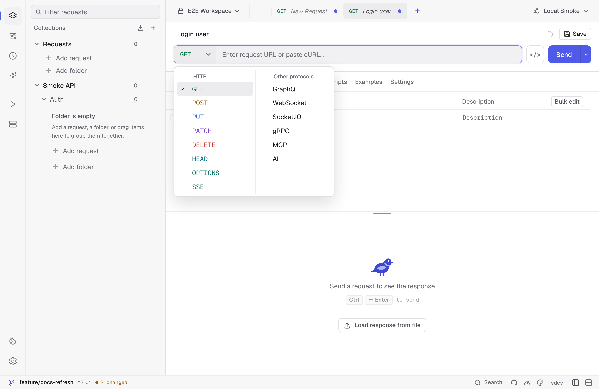

A new request always starts as HTTP — the `+` in the tab bar, `Cmd/Ctrl N`, and **Add request** in the sidebar open it straight away, with no dialog. To use another protocol, pick it from the menu at the start of the address bar, or run **New GraphQL request**, **New WebSocket request**, **New Socket.IO request**, **New gRPC request**, **New MCP request**, or **New AI request** from the command palette.

The address bar lists HTTP methods on the left and other protocols on the right. You can change a draft or a saved request, including one with a URL. For example, choosing `POST` on a GraphQL request switches it to HTTP. Stop an active request or disconnect its session before changing protocols. In **File**, the picker updates the open YAML draft.

## At a glance

| Type | Use it for | Main tabs | Response surface | Desktop Collection Runner |
|------|------------|-----------|------------------|----------------|
| [HTTP](/docs/guides/request-types/http/) | REST, JSON APIs, forms, files, regular request/response flows | Params, Auth, Headers, Vars, Body, Scripts, Settings | Body, Headers, Scripts | Yes |
| [GraphQL](/docs/guides/request-types/graphql/) | Queries, mutations, variables, schema exploration | Query, Auth, Headers, Vars, Schema, Scripts, Examples | Body, Headers, Scripts | Yes |
| [SSE](/docs/guides/request-types/sse/) | `text/event-stream` subscriptions over HTTP | Params, Auth, Headers, Body, Settings | SSE event stream | No |
| [WebSocket](/docs/guides/request-types/websocket/) | Raw `ws://` / `wss://` sessions | Params, Auth, Headers, Message, Settings | Frames, handshake, logs | No |
| [Socket.IO](/docs/guides/request-types/socket-io/) | Socket.IO servers with namespaces/events | Params, Auth, Headers, Events, Message, Settings | Events, handshake, logs | No |
| [gRPC](/docs/guides/request-types/grpc/) | Protobuf RPCs with metadata/reflection/proto files | Message, Auth, Metadata, Vars, Service definition, Scripts, Settings | Messages, metadata, trailers, scripts | Yes |
| [MCP](/docs/guides/request-types/mcp/) | Model Context Protocol servers — list their tools and call one by hand | Arguments, Auth, Headers, Scripts, Settings | Result, raw exchange, notifications | No |
| [AI](/docs/guides/request-types/ai/) | Prompts to OpenAI, Anthropic and OpenAI-compatible models, with MCP tools | Prompt, Auth, Headers, Tools, Scripts, Settings (model) | Conversation, raw stream, tests | No |

The [CLI runner](/docs/guides/cli-runner/run/#what-it-runs) handles HTTP and GraphQL. Use the desktop Collection Runner to include gRPC.
