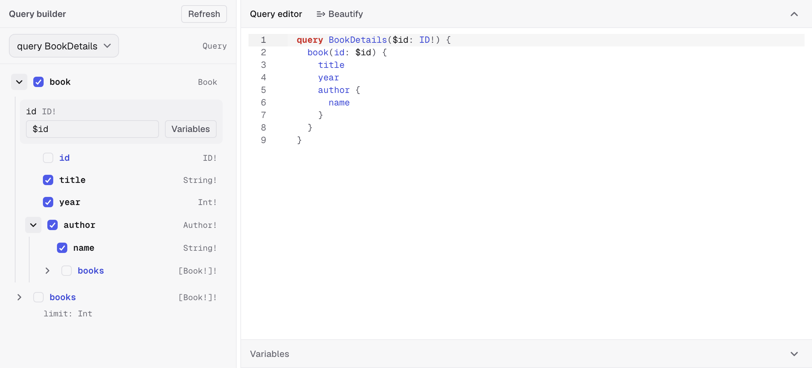

GraphQL requests use `POST` and store the query, variables, and operation name as a GraphQL payload. The Query tab is optimized for editing GraphQL text and variables; the Schema tab can hold an imported schema or an introspection result.

GraphQL still uses the normal auth, headers, scripts, environments, cookies, and response viewer paths. Exports preserve GraphQL where the target format supports it.

## Build an operation from a schema

1. Create a **GraphQL Request**, enter the endpoint URL and open **Query**. Select **Use GraphQL introspection**. Kurlo uses the request’s auth and headers. You can also import a schema from a local SDL or introspection JSON file.
2. In **Query builder**, expand a type to browse its fields. Check the fields you want in the response. You can select fields from more than one branch. For an interface or union, expand a concrete type to select fields inside an inline fragment.
3. Choose **Query** beside the URL to send the operation. The example below asks for a book’s title, year and author’s name.

### Arguments and variables

Selecting a field with a required argument creates a typed variable, binds it to the argument and adds an initial value in **Variables**. Click **Variables** beside the argument to set the value before sending. For example, `book(id: $id)` with `{"id": "1"}` reads book 1.

For an optional argument, enter a GraphQL literal such as `10` or `"paperback"`, or choose **Use variable**. Press **Enter** or leave the input to apply it. You can also enter an existing variable name such as `$limit`. Removing a field or switching to a literal removes variable definitions that the operation no longer uses.

You can edit the same operation in **Query editor**. Each checkbox controls all direct selections of that field under the same path in the active operation. Aliases and named fragment spreads stay in the text editor. When the tree and editor are side by side, focus the divider and press the left or right arrow to resize the tree. Use the operation menu above the tree to select another named operation or add an operation supported by the schema.
