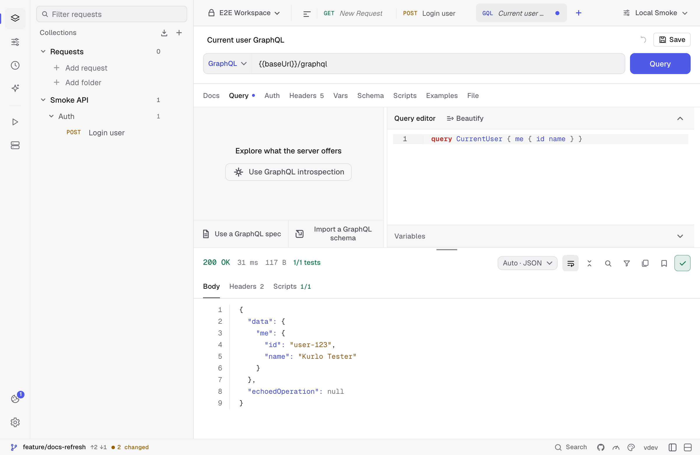
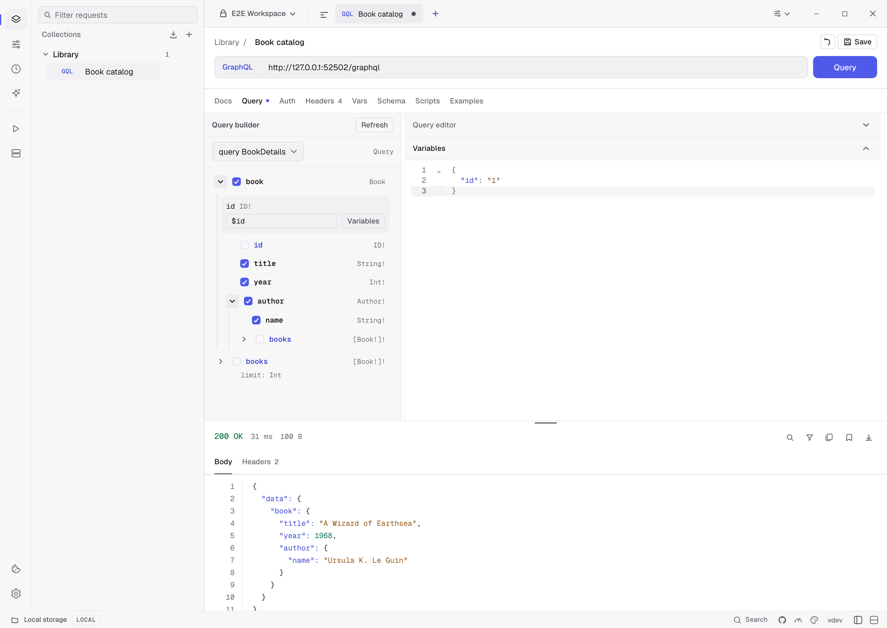

GraphQL requests use `POST` and store the query, variables, and operation name as a GraphQL payload. The Query tab is optimized for editing GraphQL text and variables; the Schema tab can hold an imported schema or an introspection result.

GraphQL still uses the normal auth, headers, scripts, environments, cookies, and response viewer paths. Exports preserve GraphQL where the target format supports it.

## Build an operation from a schema

1. Create a **GraphQL Request**, enter the endpoint URL and open **Query**. Select **Use GraphQL introspection**. Kurlo uses the request’s auth and headers. You can also import a schema from a local SDL or introspection JSON file.
2. In **Query builder**, expand a type to browse its fields. Check the fields you want in the response. You can select fields from more than one branch. For an interface or union, expand a concrete type to select fields inside an inline fragment.
3. Choose **Query** beside the URL to send the operation. The example below asks for a book’s title, year and author’s name.

### Arguments and variables

Selecting a field with a required argument creates a typed variable, binds it to the argument and adds an initial value in **Variables**. Click **Variables** beside the argument to set the value before sending. For example, `book(id: $id)` with `{"id": "1"}` reads book 1.

For an optional argument, enter a GraphQL literal such as `10` or `"paperback"`, or choose **Use variable**. Press **Enter** or leave the input to apply it. You can also enter an existing variable name such as `$limit`. Removing a field or switching to a literal removes variable definitions that the operation no longer uses.

You can edit the same operation in **Query editor**. Each checkbox controls all direct selections of that field under the same path in the active operation. Aliases and named fragment spreads stay in the text editor. When the tree and editor are side by side, focus the divider and press the left or right arrow to resize the tree. Use the operation menu above the tree to select another named operation or add an operation supported by the schema.

## Subscriptions

When the selected operation is a `subscription`, the button beside the URL reads **Subscribe** instead of **Query**. Kurlo sends a subscription over a WebSocket, not as an HTTP `POST`.

1. Enter the GraphQL endpoint as the URL. Kurlo connects to the same address over WebSocket: `http://` becomes `ws://` and `https://` becomes `wss://`. If the server serves subscriptions on another path, use that path.
2. Write the subscription in **Query editor**, or add one from the operation menu of the query builder. When the document has several operations, select the subscription by name.
3. If the server reads credentials from the connection, open **Connection payload** next to **Variables** and enter a JSON object, such as `{"authorization": "Bearer {{token}}"}`. Kurlo sends it in `connection_init`. The tab appears for subscriptions, or when a payload is already saved.
4. Choose **Subscribe**. The response panel shows the WebSocket message log: the frames Kurlo sends, the server's `connection_ack` and one message for each event. Choose **Unsubscribe** to stop.

Kurlo offers the `graphql-transport-ws` protocol of the [`graphql-ws`](https://the-guild.dev/graphql/ws) library and the older `graphql-ws` protocol of `subscriptions-transport-ws`, and uses the one the server picks. A `Sec-WebSocket-Protocol` header on the request replaces this choice. The handshake carries the request's auth, headers and cookies, and uses its proxy and certificate settings. Kurlo answers protocol pings and keep-alive messages and marks them as system messages, so **Sent messages** and **Received messages** in the log filter show them apart from events.

The subscription ends when the server sends `complete` or an error, and Kurlo then closes the connection. **Unsubscribe** sends `complete` (`stop` for the older protocol) before it closes. If the server does not acknowledge `connection_init` within 30 seconds, Kurlo reports it and disconnects.

Pre-request and test scripts do not run for a subscription. The Collection Runner, `kurlo run` and MCP tools send GraphQL requests over HTTP only, so they cannot run a subscription. GraphQL over Server-Sent Events (`graphql-sse`) is not supported.
