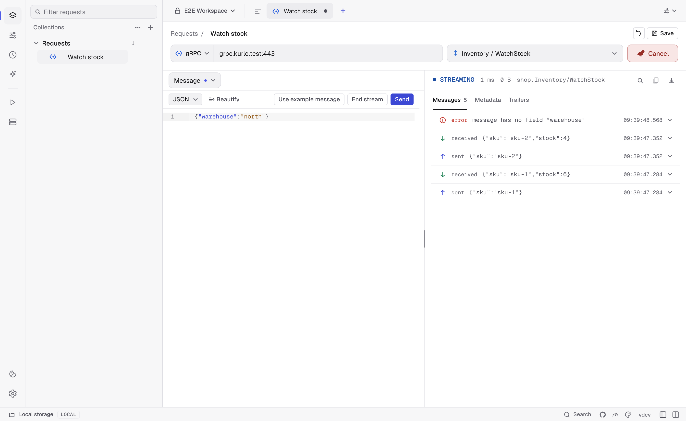
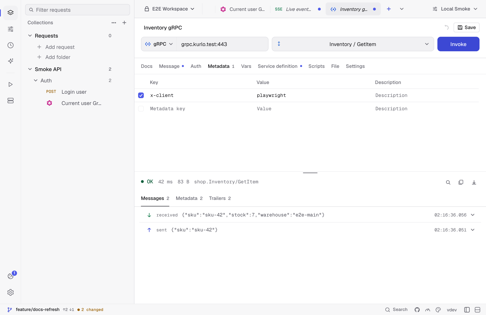

gRPC requests target `host:port` or a `grpc://` / `grpcs://` style target. Kurlo can discover services by reflection when enabled, or use a selected `.proto` file with import paths.

The request body is JSON in protobuf JSON shape. Metadata lives in its own tab. The response panel separates:

- Messages.
- Response metadata.
- Trailers.
- Script output and test results.

gRPC supports pre-request/test scripts, environment variables, collection defaults, and runner reports.

## Interactive streaming

Client-streaming and bidirectional methods are interactive in the editor:

1. Select the method and press **Invoke**. Kurlo opens the stream and sends nothing yet.
2. Write a message in the **Message** tab and press **Send**, or the send shortcut while the editor has focus. `{{variables}}` are resolved when you send. Repeat for every message.
3. Press **End stream** when you are done. The server then sends its response or finishes its stream, and the trailers and test results appear.

Sent and received messages appear in **Messages** as they happen, so a bidirectional call shows each reply next to the message that caused it. Invalid JSON is not sent: the editor marks the error. A message the method cannot accept, such as one with an unknown field, is listed as an error and the stream stays open. **Cancel** ends the call without waiting for the server.

The Collection Runner is not interactive: it sends every JSON object in the message, one after another, and then ends the stream.

## Long streams

A long server stream keeps its latest 500 messages in the Messages list and the response body. Messages keep their numbers, so the list then starts at the first one still kept; the response size still counts every message received.

For servers that require mutual TLS, set a **Client certificate (mTLS)** in the gRPC **Settings** tab. It works the same way as for HTTP — see [Client certificate](/docs/guides/request-settings/client-certificates/#client-certificate-mutual-tls) — and is sent whenever the call uses TLS (**Use TLS** on, or a `grpcs://` target). Reflection uses the same connection, so it works against mTLS servers too.

To bring a native gRPC request from Postman, import its [Postman v3 folder or `*.request.yaml` file](/docs/guides/import-export/postman/#postman-v3-folders). To take a native gRPC request into Postman, [export its collection as a Postman v3 folder](/docs/guides/import-export/postman/#export-to-postman-v3). Add the service's `.proto` files in Postman if the server does not support reflection.

