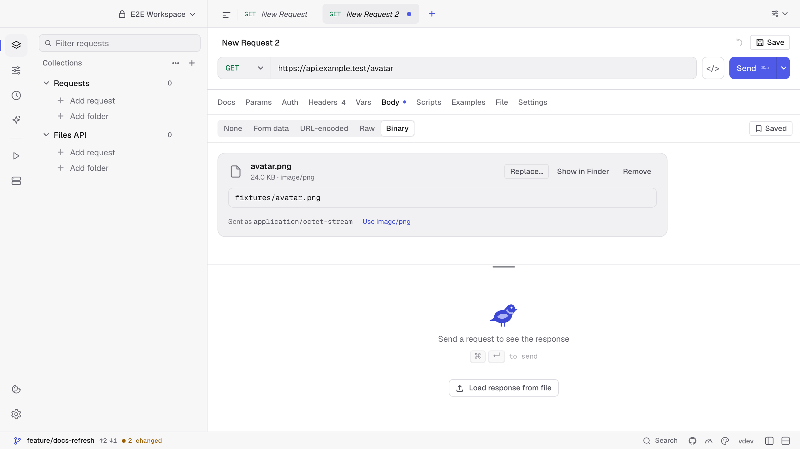

HTTP is the default mode. It supports:

- Methods: `GET`, `POST`, `PUT`, `PATCH`, `DELETE`, `HEAD`, `OPTIONS`, and `SSE`.
- Query params, path variables, and headers as editable rows.
- Auth, body, scripts, request notes, and per-request settings.
- JSON, text, XML, HTML, form-data, urlencoded, GraphQL-shaped body, and binary-file bodies.
- cURL import from the URL bar.

Use HTTP for normal REST APIs. Use the `SSE` method only when the endpoint keeps an event stream open.

The method menu lists the HTTP methods on the left and the other protocols on the right.

To copy the request as cURL or client code, open [Code snippets](/docs/guides/code-generation/).

## Send a file as the body

Choose **Body → Binary** to send a file byte for byte. Drop a file onto the panel, or choose **Choose file…**.

- **Relative paths.** A file inside the workspace folder (the folder with `kurlo.yml`) is saved as a path relative to that folder, such as `fixtures/avatar.png`. Anyone who opens the workspace from Git sends the same file, and so do `kurlo run` and `kurlo mcp`. A file outside the folder keeps its absolute path and only works on your computer; Kurlo says so under the path. Files you attach in **Form data** are saved the same way: drop a file onto the value cell of a **File** row or click **Choose file…**, then edit the path there, with `{{variables}}` if you need them.
- **Edit the path.** The path field accepts `{{variables}}`. Kurlo checks the file when it can resolve every variable, otherwise when you send.
- **File details.** The panel shows the file's size and type. **File not found** means nothing is at the path on this computer; choose **Replace…** or fix the path. **Show in Finder** (or Explorer, or your file manager) opens the file's folder.
- **Content type.** Kurlo sends `application/octet-stream` unless the request has a `Content-Type` header. When the file has a known type, **Use image/png** (or the type Kurlo detected) adds that header for you.
- **Size limit.** A file body can be up to 256 MB.

## Suggestions while you type

Kurlo finishes what you are typing in faded text. Press `Tab` to accept it, or `Escape` to hide it.

- **URL.** Start typing a URL and Kurlo offers the rest of one you have sent or saved in this workspace, newest history first. In the URL field, `→` at the end of the text accepts too. Typing the start of a request's name offers that request's URL instead, as in `create order → {{baseUrl}}/orders`. Suggestions come from requests of the same kind, so an HTTP request does not offer WebSocket addresses.
- **JSON body.** When the request has [saved examples](/docs/guides/examples/), Kurlo offers the next key at the point where one can go: inside quotes you have opened, or on a new line after a comma. It uses the example bodies of this request, including the ones an OpenAPI import created from the spec's schemas, follows the nested object you are in, and skips keys that are already there.

## Path variables

A path segment that starts with a colon is a path variable: type `{{baseUrl}}/users/:userId/posts/:postId` and the **Params** tab lists `userId` and `postId` under **Path variables**, below the query params. Fill in the values there, and Kurlo puts them into the URL when it sends the request, so `/users/:userId` goes out as `/users/42`. The URL field keeps showing `:userId`.

- The rows follow the URL. Adding `:name` to the path adds a row, and removing it from the path removes the row. Renaming a variable means editing the URL.
- Only a whole segment counts. `/users/:id` has a variable, while `/v1:beta` and `http://localhost:8080` do not, and the query string and fragment are left alone.
- A value can use `{{variables}}`, such as `{{userId}}` from the environment.
- Characters that would change the URL's structure, such as `/`, `?`, `#` and spaces, are percent-encoded. Sequences that are already encoded, like `%2F`, are kept as they are.
- A variable with an empty value stays in the URL as `:name`.
- Pre-request scripts see the URL with `:name` in it, as Postman's do, and can read and change the values with [`pm.request.pathVariables`](/docs/reference/scripting-api/).
- Path variables apply to HTTP, GraphQL, and SSE requests. Copy as cURL and generated code put the values into the URL. The mock server treats `:name` as "any value" when it matches requests against saved examples.
