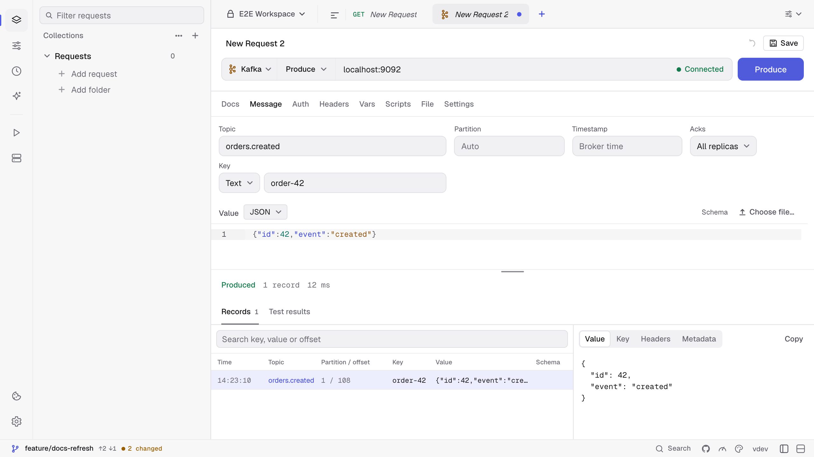
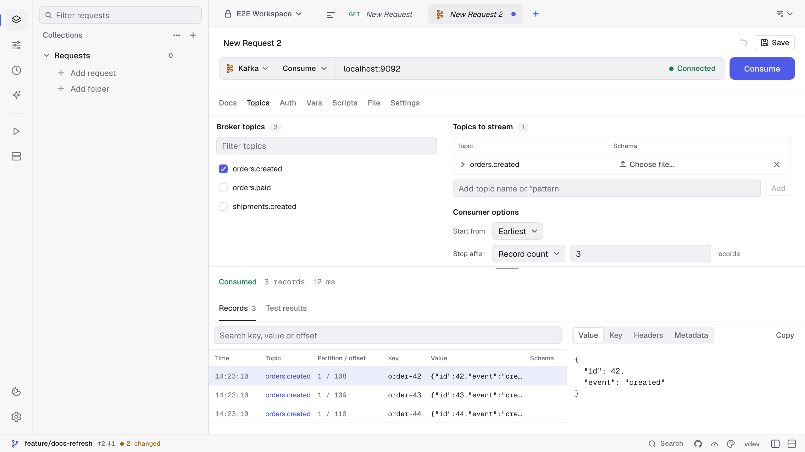

Choose **Kafka** in the protocol picker. Enter one or more comma-separated bootstrap brokers, such as `localhost:9092`. **Test connection** lists the topics your credentials can see. Broker addresses, the topic and message fields accept workspace variables.

## Produce a record

Choose **Produce** and enter a topic. Select JSON, text, hex or base64 for the value. Choose **tombstone** to send a null value. Keys support text, JSON, hex or base64. An optional key lets the broker client select a partition consistently. Enter a partition to choose one explicitly. Use **Headers** for record headers. **Acknowledgements** controls whether the producer waits for the leader or all in-sync replicas. With **None**, the broker does not return an offset.

Click **Produce** to send the record. The records list shows its time, topic, partition, offset, key and value. Next to it, **Value**, **Key**, **Headers** and **Metadata** show each part of the selected record; **Metadata** holds the topic, partition, offset and timestamp. Binary data that cannot be displayed as UTF-8 appears as base64.

## Consume records

Choose **Consume**, test the connection and select topics. You can also enter a topic manually or use a regular expression beginning with `^`. Click a selected topic to specify partition numbers, a starting offset or an exclusive end offset. Kurlo reads those partitions directly without committing consumer-group offsets.

Choose **Earliest** to see existing records or **Latest** to watch new arrivals. You can also start at an offset or timestamp. Stop after a record count, a duration, an idle period, or a timestamp. Durations use milliseconds. Timestamps accept RFC 3339 or Unix milliseconds. The request timeout in **Settings** covers connecting to the brokers and looking up partitions. The consumer can then wait for new records until its stop condition. A run holds up to 10,000 records and 16 MiB of record data.

Click **Consume**, then select a record to inspect its value or metadata. Search the stream or filter by topic. **Stop** keeps the records already received.

## Connections, schemas and scripts

Enable TLS in **Settings** for encrypted brokers. You can select a client certificate for mutual TLS. Choose SASL credentials in **Auth** for PLAIN or SCRAM, a bearer or OAuth 2.0 access token for OAUTHBEARER, or AWS credentials for MSK IAM.

Link a local JSON Schema or an AsyncAPI JSON/YAML file to the producer message or an individual subscription. For AsyncAPI, Kurlo matches the topic to the channel and validates the JSON value against its message payload. **Metadata** shows validation details. Schema validation is informational and runs after the record is produced or received.

Use **Scripts** to prepare a request and assert on the result. A consumer's on-message script runs for each record. For example, a JSON order message can be checked with `pm.test("order has an id", () => pm.expect(pm.message.value.id).to.exist)`. After consuming, `pm.response.messages` contains the received records. Save the request to reuse the same settings in the Collection Runner or with `kurlo run`.
