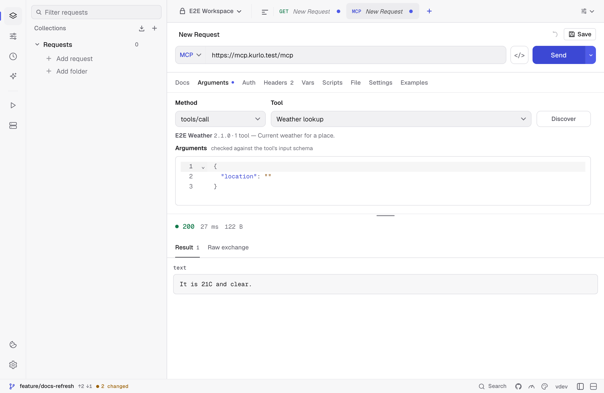

## MCP

An MCP request calls a [Model Context Protocol](https://modelcontextprotocol.io) server — the servers agents talk to — without an agent in the loop. Kurlo speaks protocol revision **2026-07-28**, which is stateless: every call is a single HTTP POST to the server's endpoint, so an MCP call is an ordinary saved request that can be replayed, diffed, scripted and committed.

Most servers in use today were built for the earlier revisions **2025-11-25**, **2025-06-18** and **2025-03-26**, which need a session. Kurlo finds that out by itself: when a server does not answer the stateless call, Kurlo sends `initialize` and `notifications/initialized`, keeps the `Mcp-Session-Id` the server hands out, and sends that call and the later ones to the same endpoint in the session. The panel then shows the revision next to the server's name, for example *MCP 2025-06-18*. If the server forgets the session, Kurlo opens a new one and sends the call again. The handshake carries the request's URL, headers and auth, but not its scripts, which run once around the call itself. To pin a revision, set `mcpProtocolVersion` on the request in its YAML file.

Put the server's endpoint in the URL bar, then press **Discover**. Kurlo calls `server/discover` and follows it with `tools/list`, `resources/list` and `prompts/list` for the capabilities the server actually declares, so a server with no prompts is never asked for any. The panel then names the server, its version and what it holds.

Choose a method and, for `tools/call`, `resources/read` or `prompts/get`, the tool, resource or prompt to address. Picking a tool seeds the **Arguments** editor from the tool's own input schema, and the arguments are checked for being a JSON object before anything is sent.

The response panel has three views:

- **Result** — the content blocks the server returned, its `structuredContent`, and, when a tool asked for more input, the `inputRequests` it sent back.
- **Raw exchange** — the JSON-RPC envelope exactly as it arrived, including the individual frames when the server answered with a stream. This is the view that makes a failing tool call diagnosable.
- **Notifications** — the progress and log notifications a streamed answer carried before its result.

What Kurlo checks on your behalf:

- **A tool that contradicts its own output schema is called out.** If the server publishes an `outputSchema` and its `structuredContent` does not match, the mismatch is listed as a warning — and the content is still shown, because the server is the one at fault.
- **A tool whose `x-mcp-header` annotations the specification forbids cannot be called.** Kurlo names the reason instead of quietly dropping the tool from the list, which is what a conforming agent client does.
- **Headers the protocol derives from the body are yours to read, not to set.** `Mcp-Method`, `Mcp-Name`, `MCP-Protocol-Version` and the `Mcp-Param-*` headers are built from the call; a header of the same name in the Headers tab is replaced and you are told so, because a server must reject a request whose headers and body disagree.

Auth, proxy, client certificates, redirects and the response cap are the ordinary HTTP ones — an MCP call is an HTTP request, and it carries the same settings.

Not in this release: the **stdio** transport, so servers launched as a local command (`npx some-server`) cannot be reached yet; the old HTTP+SSE transport of revision `2024-11-05`; `subscriptions/listen`; and sampling, which Kurlo declines because it has no model and is not going to acquire one.
