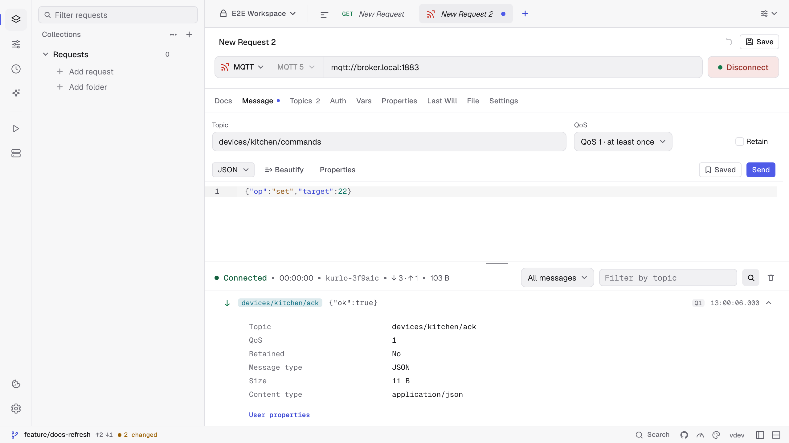
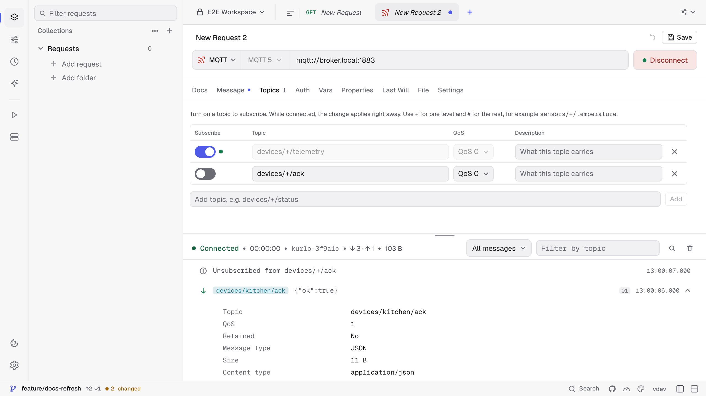
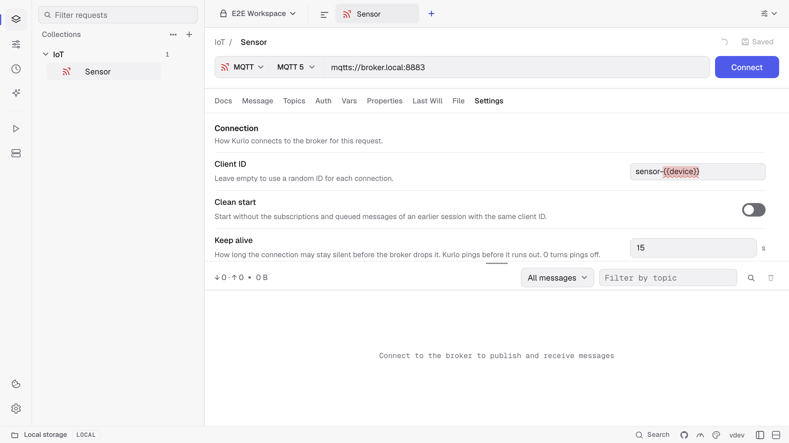

Choose **MQTT** in the protocol picker and enter the broker URL. Kurlo accepts:

| URL | Transport | Default port |
|-----|-----------|--------------|
| `mqtt://host` or `host` | TCP | 1883 |
| `mqtts://host` | TLS | 8883 |
| `ws://host/path` | WebSocket | 80 |
| `wss://host/path` | WebSocket over TLS | 443 |

A WebSocket URL without a path connects to `/mqtt`. Pick **MQTT 5**, **MQTT 3.1.1** or **MQTT 3.1** next to the URL, then click **Connect**. The connection stays open until you click **Disconnect**. While connected, the protocol picker is locked. Broker URLs, topics, payloads, client IDs and properties accept workspace variables.

## Subscribe to topics

Open **Topics**, enter a topic and click **Add**. Use `+` for one level and `#` for every level below, as in `devices/+/telemetry` or `devices/#`. Kurlo rejects a filter with a misplaced wildcard before it reaches the broker.

Topics that are turned on are subscribed when you connect. While connected, turning a topic on subscribes to it at once and turning it off unsubscribes. A green dot marks topics the broker has confirmed. Pick the QoS for each subscription and add a description to document what the topic carries.

## Publish a message

Open **Message**, enter the topic, choose a QoS and turn on **Retain** if the broker should keep the message for new subscribers. The message type can be **Text**, **JSON**, **Base64** or **Hexadecimal**. Base64 and hexadecimal payloads are decoded and sent as raw bytes. Press **Send** or `Cmd/Ctrl Enter` while connected. A QoS 1 or 2 message waits up to 15 seconds for the broker to acknowledge it; if the connection drops first, Kurlo reports the error at once.

With MQTT 5, **Properties** in the message toolbar adds a content type, response topic, correlation data, message expiry, topic alias, the UTF-8 payload flag and user properties.

**Saved** keeps messages you publish often: a name, the topic, the payload, its type, QoS and the retain flag. Click a saved message to load it, or send it straight away while connected.

## Read messages

The panel below the editor lists connection events, sent and received messages, newest first. Each topic has its own colour. Filter by **Received**, **Sent** or **Connection events**, type a topic filter, or search topics and payloads. The topic filter matches part of a topic name, or a whole MQTT filter such as `plant/+/telemetry` or `plant/line-1/#`. The log and the topic list draw only the rows on screen, so thousands of messages or subscriptions stay responsive. Click a message to see its topic, QoS, retain flag, size, MQTT 5 properties and the formatted payload. A payload that is not valid UTF-8 is shown as Base64. The panel keeps the last 5,000 messages and shows the first 256 KB of a larger message; its full size is listed in the details. When a broker sends faster than the log can draw, Kurlo keeps the newest messages and notes how many it left out. Received messages are still acknowledged to the broker.

## Authorization, properties and last will

- **Auth**: choose **Username and password** to send credentials with CONNECT.
- **Properties** (MQTT 5): session expiry, receive maximum, maximum packet size, topic alias maximum, requests for response and problem information, and user properties.
- **Last Will**: a message the broker publishes when the connection drops without a clean disconnect. Set its topic, QoS, retain flag and payload. MQTT 5 adds a delay and the same properties as a published message.

To start from a spec, [import an AsyncAPI document](/docs/guides/import-export/asyncapi/#mqtt-session): Kurlo fills in the broker, subscriptions and saved messages.

## Settings

- **Client ID**: empty uses a new random ID for each connection.
- **Clean session** (**Clean start** in MQTT 5): starts without the subscriptions and queued messages of an earlier session. Turn it off and set a fixed client ID to resume a session.
- **Keep alive**: how long, in seconds, the connection may stay silent before the broker drops it, 60 by default. Kurlo pings before it runs out. `0` turns pings off.
- **Connection timeout**: 30 seconds by default.
- **Auto reconnect**: reconnects after the connection drops, up to 10 attempts, and subscribes to the same topics again. When the attempts run out or the broker refuses the connection, the request shows the error and **Connect** starts again.
- **Verify server certificate** and **Client certificate** apply to `mqtts://` and `wss://` brokers.
- **Proxy**: `ws://` and `wss://` brokers use the request, collection or global proxy, including the system proxy. `mqtt://` and `mqtts://` brokers go through an HTTP, HTTPS or SOCKS5 proxy only when one is set in Kurlo, with **On** or a proxy URL; system proxy variables are not used for them, because most HTTP proxies allow tunnels only to web ports. Bypass rules apply to both.

MQTT requests are saved in the workspace YAML and exported to Postman and Insomnia files that Kurlo can import again. They do not run scripts, and the Collection Runner and `kurlo run` skip them because a connection does not finish on its own. Kurlo does not support MQTT 5 enhanced authentication (AUTH packets).
