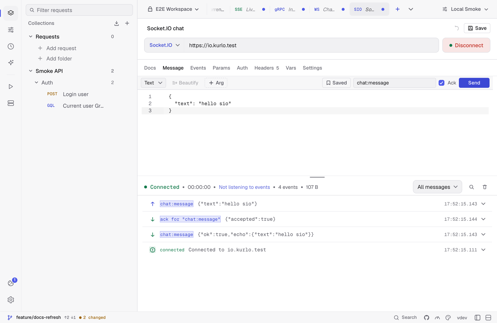

Socket.IO mode speaks the Socket.IO protocol rather than raw WebSocket frames. Configure:

- Client version: v2 or v3.
- Path, usually `/socket.io`.
- Namespace, usually `/`.
- Event name, arguments, and ack behavior. Empty arguments are not sent; to send an empty string, write `""` in JSON.
- Reconnect attempts and interval.

Socket.IO events are displayed with namespace, direction, args, and system/error rows. Cookies, headers, and the Authorization tab are applied to the Engine.IO handshake unless the request disables the cookie jar. As with WebSocket, there is no Scripts tab.

