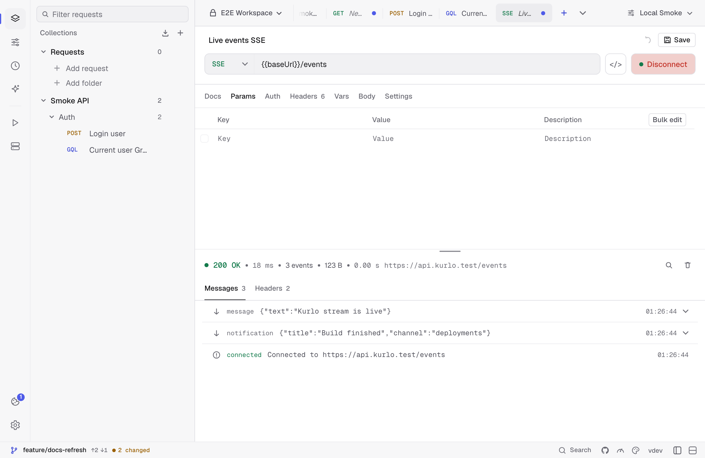

## Server-Sent Events

SSE is an HTTP request with long-lived streaming semantics:

1. Create an HTTP request.
2. Set the method to `SSE`.
3. Enter the stream URL and any auth/headers.
4. Press **Connect**.

Kurlo adds `Accept: text/event-stream`, `Cache-Control: no-cache`, and `Connection: keep-alive` when building the request. Events appear as they arrive and the session is written to history once the stream connects or errors.

An SSE request has no Scripts tab: a subscription is opened rather than sent, and pre-request and test scripts do not run on that path. Reconnection is configurable — see [SSE-specific settings](/docs/guides/request-settings/streaming/#sse-specific-settings).

The `SSE` method subscribes with a `GET` and no body. An endpoint that streams events back from a `POST` — the streaming mode of most LLM APIs — is sent as an ordinary `POST`: Kurlo reads the stream until the server closes it and shows the raw events as the response body, within the request timeout.

The SSE event list keeps the latest events bounded for UI performance. Clear or restore visible events from the SSE panel while the session is open.

