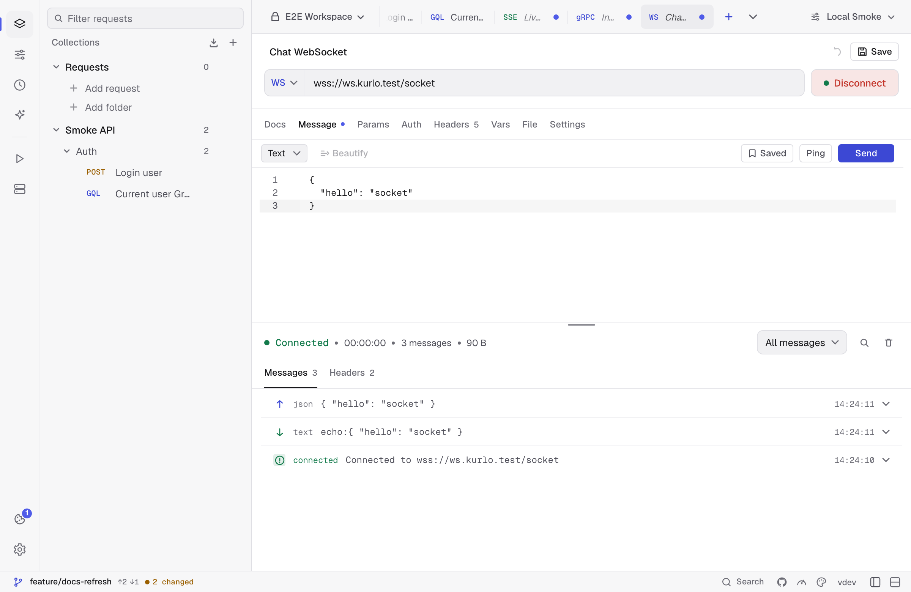
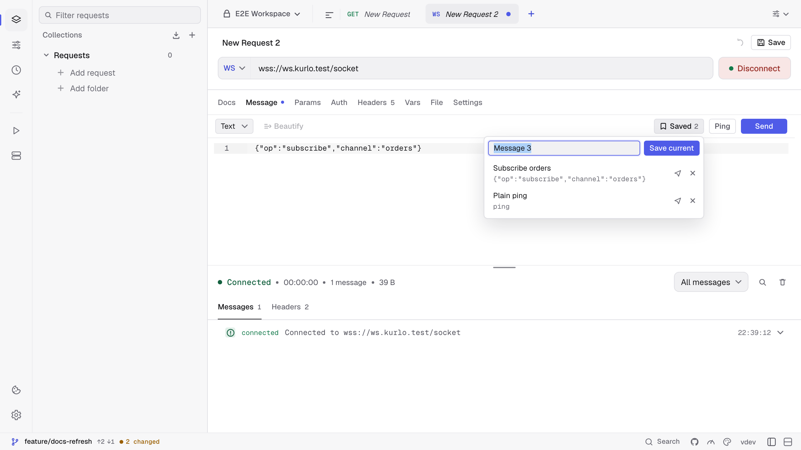

WebSocket requests connect to `ws://` or `wss://` URLs. Kurlo shows:

- A handshake record with request/response headers.
- Incoming/outgoing frames.
- Text, binary, ping, pong, close, reconnect, and error events.
- Reconnect settings and a max-message-size guard.

Sending a close frame ends the session even when the server never answers it: Kurlo waits one second for the server's reply, then closes the connection. Use the Message tab to send a text or binary payload after connecting. Per-request headers and cookies are applied to the handshake, and so is the Authorization tab — Bearer, Basic, Digest and API-key auth all go out with the upgrade request, the same way they would on an ordinary send. There is no Scripts tab: the handshake does not run pre-request or test scripts.

## Saved messages

**Saved** in the Message tab keeps messages you send again and again: a subscribe frame, a ping in your own format, a test payload. Type the message, open **Saved**, name it and press **Save current**. Click a saved message to put it back in the editor, or use its send button to send it straight away while connected.

A request keeps up to 100 saved messages of up to 256 KB each; at the limit **Save current** is turned off until you delete one. From nine messages on, a search field above the list finds messages by name, content, event or argument. A request file that already holds more than 100 shows the first 100 and finds the rest by search; nothing is removed.

Saved messages are stored with the request as `savedMessages` in its YAML file, so they are shared through Git with the rest of the collection. Socket.IO requests have the same menu next to the event name; a saved Socket.IO message keeps the event name, every argument and the **Ack** setting.

