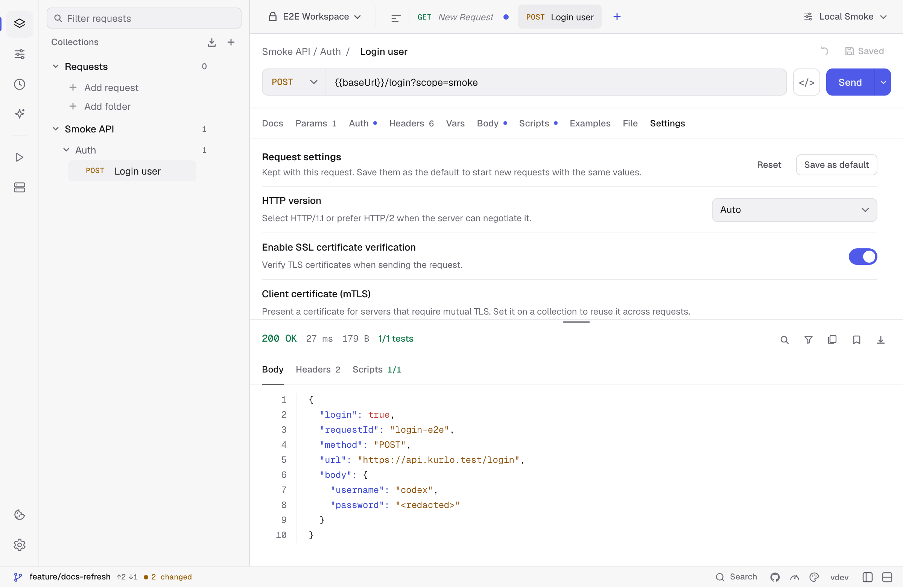

## Body view

The body view auto-detects how to render the payload:

- **JSON** — syntax-highlighted, two-space indent, line numbers in the gutter. Folding is enabled if your response is deeply nested.
- **HTML** / **XML** — syntax-highlighted with line numbers.
- **Plain text / unknown** — rendered verbatim. No reformatting.
- **Binary or `application/octet-stream`** — Kurlo shows the detected type and size. Click **Preview** for a supported format or **Save to file** to keep the body.
- **Server-Sent Events (`text/event-stream`)** — Kurlo switches automatically to the SSE panel with streamed event rows.
- **WebSocket / Socket.IO / gRPC** — realtime and RPC requests use dedicated response surfaces for frames, events, metadata, status, and logs.
