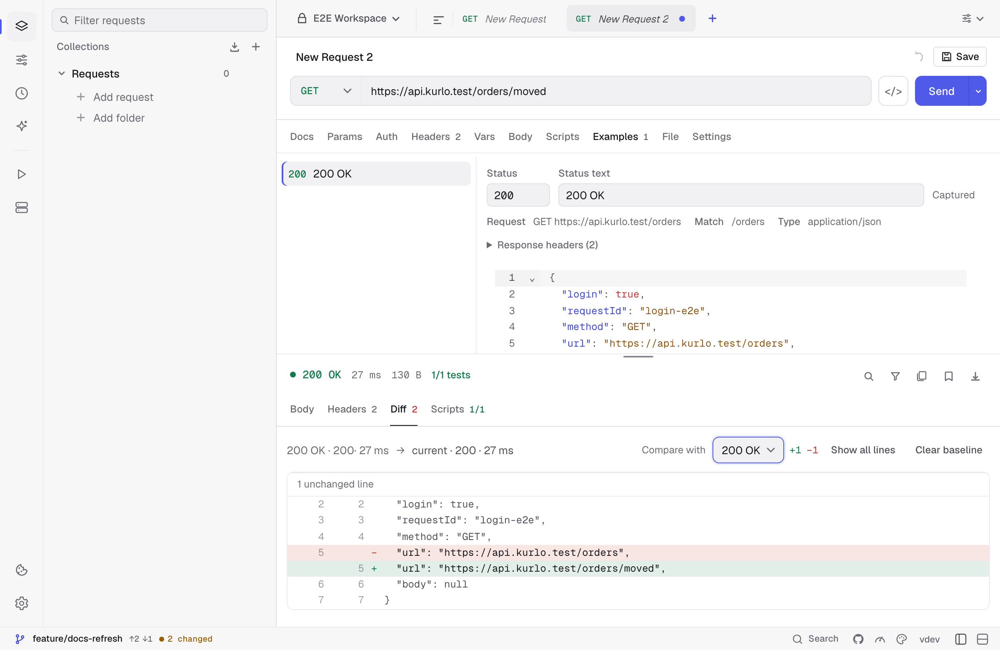

## Diff view

The *Diff* tab appears the second time you send the same request. It compares the previous response body with the current one:

- Removed lines are red, added lines are green, and both original line numbers are kept.
- Long unchanged runs collapse to a `… unchanged lines` marker — *Show all lines* expands them.
- *Clear baseline* forgets the previous response and hides the tab until the next send.

Baselines are per-request and live in memory only; they are never written to the workspace and are dropped when Kurlo restarts.

You can also diff against a **saved example** instead of the previous response. That is what stops an example from going stale: an endpoint that no longer matches the contract shows up as a diff rather than passing unnoticed. If the example the baseline pointed at is deleted, it falls back to the previous response. See [Response examples](/docs/guides/examples/).

## Saving a response as an example

**Save as example** keeps the response — status, headers and body — next to the request that produced it, as a file in your workspace rather than something only you can see. Secrets are redacted on capture. Examples are what the [mock server](/docs/guides/mock-server/) replays. See [Response examples](/docs/guides/examples/).
