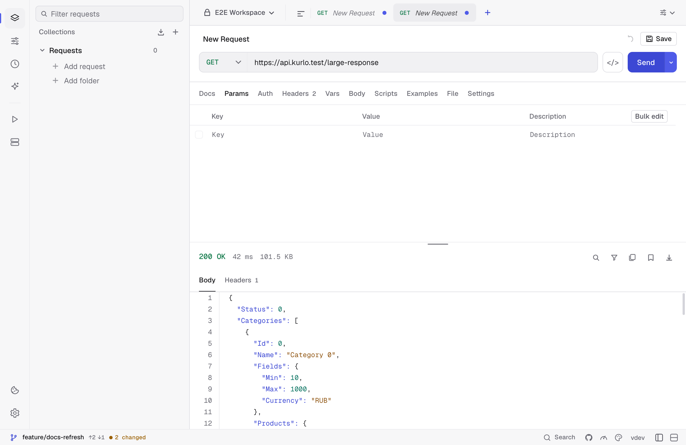

## Paging through large responses

Bodies whose reported response size is over **10 MB** are rendered in ~512 KiB pages so the editor stays responsive. The page bar appears above the body when paging is active:

> Large response preview · Page 2 / 6 · `←` `2/6` `→`

Page navigation buttons (or the keyboard shortcuts mapped to "next/prev response page" in Settings) move you through the chunks. The response itself is held intact in memory — paging only affects rendering.

## Truncation

If the server returns more than **100 MB**, Kurlo stops reading after the first 100 MB and marks the response with a banner such as *"response truncated — showing 100 MB of 450 MB"*. The status code and headers are unaffected.

The response-panel **Save to file** action and **Send and download** currently write the body Kurlo retained, so they do not recover bytes beyond this 100 MB cap.
