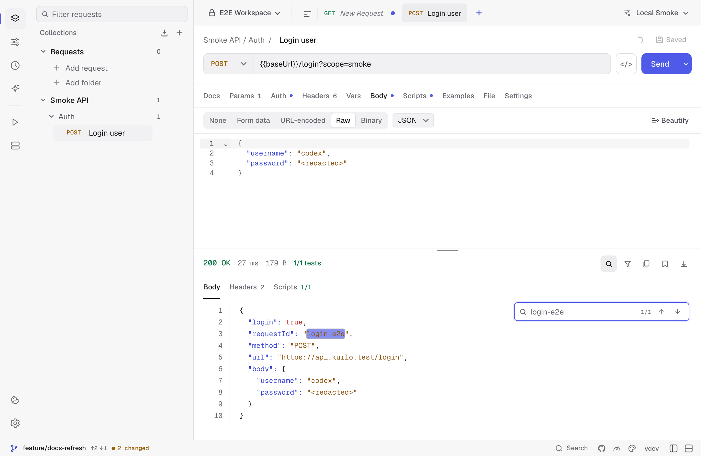
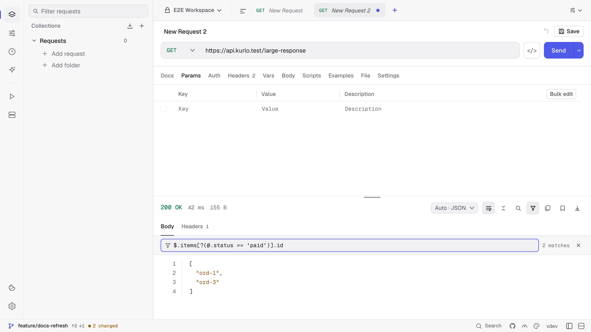

## Searching the body

Click the magnifying glass at the right end of the status row (or press the search shortcut configured in *Settings → Shortcuts*) to open the inline search bar. As you type, matches highlight in place and the counter shows `current/total`:

- `↓` / `↑` — jump to next / previous match
- `Enter` / `Shift+Enter` — same as next / previous
- `Esc` — close the search bar without clearing the response

Search is case-insensitive. For [paged responses](/docs/guides/response-viewer/large-responses/), it searches the visible page. Switch pages to search the rest.

## Filtering a JSON response

For a JSON response, the funnel button next to search opens a filter bar above the body. Type a [JSONPath](https://www.rfc-editor.org/rfc/rfc9535) expression and the body shows only what it selects; the counter on the right shows how many values matched.

| Filter | Shows |
|---|---|
| `$.data.user.email` | One value |
| `$.items[*].id` or `.items[].id` | The `id` of every item |
| `$.items[0]`, `$.items[-1]`, `$.items[1:3]` | By position, from the end, or a range |
| `$..price` | Every `price`, at any depth |
| `$.items[?(@.status == 'paid' && @.total > 20)]` | Items that match a condition |

- A path that can only pick one value, such as `$.meta.page`, shows that value. Any other path shows an array of the matches.
- A path that starts with a dot is read jq-style: `.items[].id` is the same as `$.items[*].id`. Pipes and jq functions are not supported.
- Conditions compare with `==`, `!=`, `<`, `<=`, `>`, `>=` and combine with `&&`, `||` and `!`. `?(@.isbn)` keeps items that have the field.
- If the expression has a mistake, the body stays unfiltered and the bar says what is wrong and where.
- The filter applies once you pause typing, or at once when you press `Enter`, so a large body is not filtered again on every keystroke. **Copy** always uses what is in the bar.
- Search, **Copy** and paging work on the filtered result. `Esc` or the **×** closes the filter and shows the whole body again.
- Numbers larger than JavaScript can hold exactly, such as long numeric IDs, can lose their last digits in the filtered view. The unfiltered body shows them as received.

