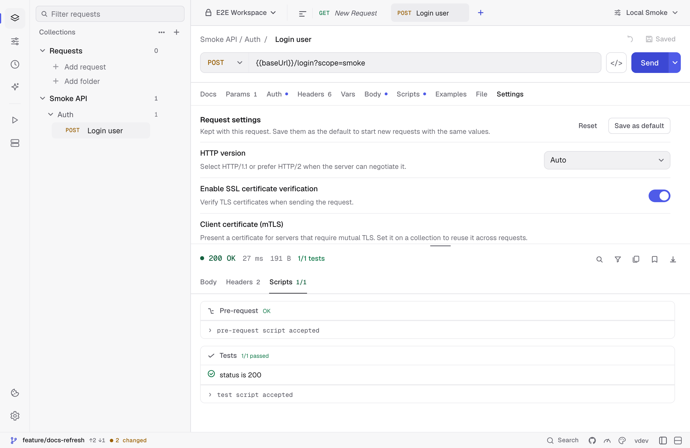

## Scripts view (test results)

The *Scripts* tab is enabled whenever a request had a pre-request or test script attached. It groups results into blocks:

- **Pre-request** — outcome of the pre-request script and any logs emitted via `pm.log(...)`. If the pre-request script errored, the request was not sent.
- **Tests** — each `pm.test(name, assertion)` is rendered as a green tick or red cross with the assertion name. The header shows a summary like `4/5 passed`.
- **Logs** — anything emitted with `pm.log(...)` from inside the test script.

If a request had no scripts attached, this tab shows *"No scripts ran for this request."*

For the full script API, see the [Scripting API reference](/docs/reference/scripting-api/).

## Common gotchas

- **"This endpoint returned an SSE stream."** Your request used a regular method but the server replied with `text/event-stream`. Switch the request to SSE mode and press *Connect*.
- **Binary download with the wrong Content-Type.** Some servers send `application/json` for what's actually a `.pdf` or `.zip`. Kurlo checks the bytes to detect the response type. Use **Save to file** to keep the binary body.
- **"Response body is empty"** with a non-2xx status. Some APIs return a status code but no body (e.g. 204 No Content). This is shown as an empty body view, not an error.
- **Slow rendering on huge JSON.** If your response is over a few MB of densely nested JSON, switch the body view to *Raw* in the editor settings to skip syntax highlighting.
