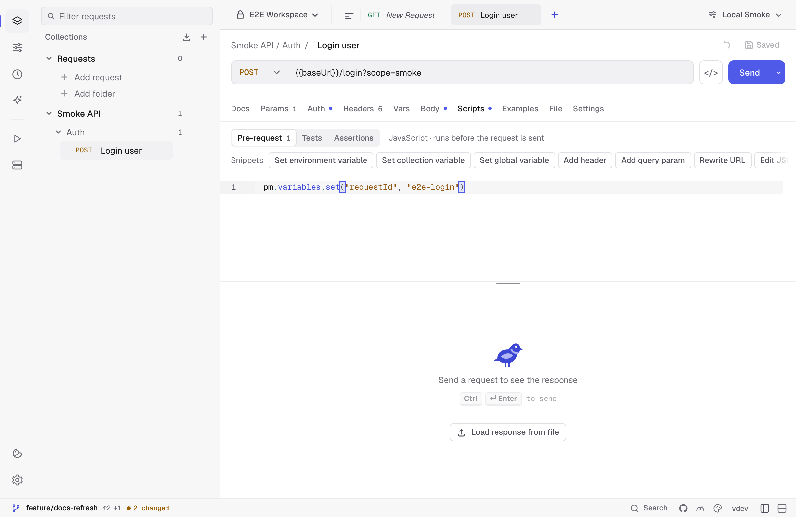
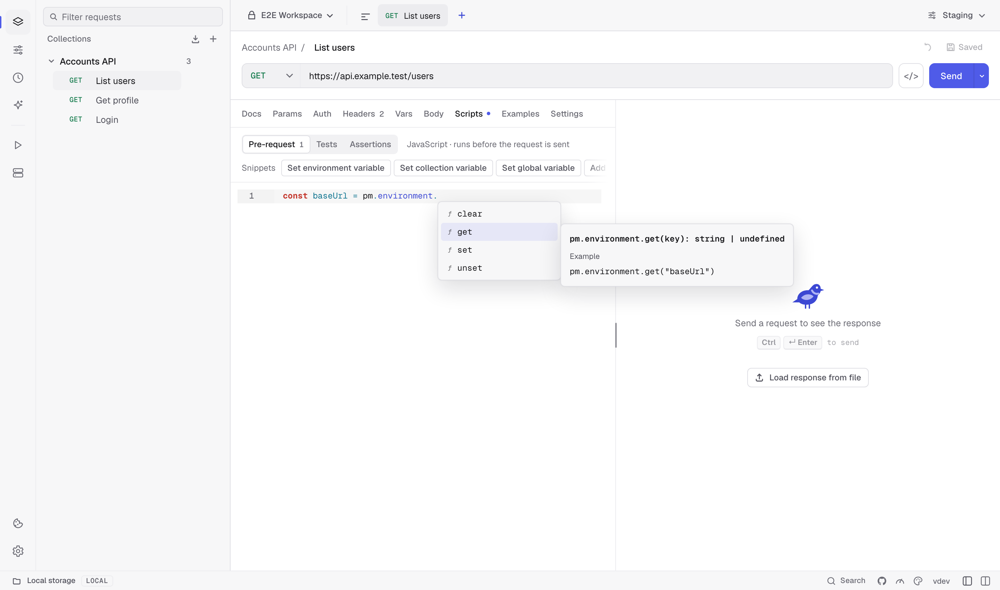

import DocsTopicIndex from "../../../../components/DocsTopicIndex.astro";

Kurlo runs scripts in a sandboxed JavaScript VM. Use the `pm.*` API to edit requests, access variables, inspect responses, run assertions, and log output. Each script has a two-second default timeout, configurable per request. The sandbox also provides iteration data, cookies, `pm.crypto` and `pm.sendRequest`.

There are two script hooks per request:

- **Pre-request** — runs after variable substitution, before the wire send. Use it to inject auth, set query params, log inputs.
- **Tests** — runs after the response is received. Use it to assert and to extract values for chained requests.

Collection variables set or removed in a pre-request script are available to the test script of the same request.

## Autocomplete

In a request, folder or collection script, type `pm.` to see the available members. Choose one with the arrow keys to see its signature and an example. Press **Enter** to insert it, **Escape** to close the list, or **Ctrl+Space** to reopen it at the cursor. In **Tests**, `pm.response.` also offers response properties and assertions.

Type the opening quote in `pm.environment.get("` to choose an enabled key from the active environment or its parents. The list shows names only. The other variable scopes offer their own keys. In a shared script, type `pm.info.requestName === "` to choose a saved request from the current collection.

<DocsTopicIndex />
