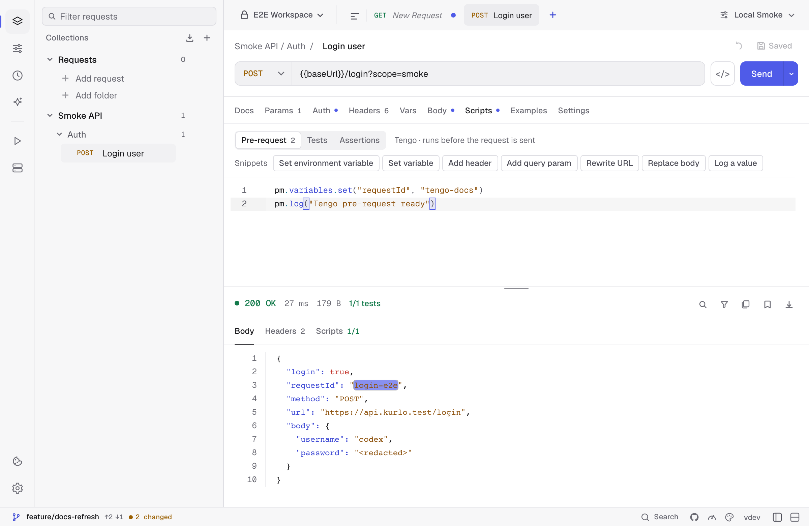

import DocsTopicIndex from "../../../../components/DocsTopicIndex.astro";

Kurlo scripts run in a sandboxed JavaScript VM by default. Existing requests can still use the legacy [Tengo](https://github.com/d5/tengo) engine. Both engines share the core `pm.*` API — variables, environment, request mutation, response, tests, expectations and logs — and the 2-second cap (configurable per request). The JavaScript engine also adds collection variables, globals, iteration data, cookies, `pm.crypto` and `pm.sendRequest`.

There are two script hooks per request:

- **Pre-request** — runs after variable substitution, before the wire send. Use it to inject auth, set query params, log inputs.
- **Tests** — runs after the response is received. Use it to assert and to extract values for chained requests.

Collection variables set or removed in a pre-request script are available to the test script of the same request.

<DocsTopicIndex />
