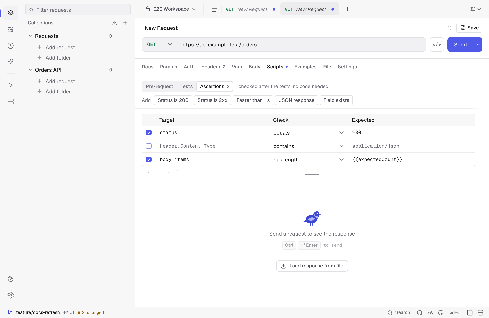

For checks that need no code, open **Scripts → Assertions** on an HTTP or GraphQL request. Each row is a target, a check and the expected value. The **Add** row inserts common ones: status 200, a 2xx status, a response faster than one second, a JSON content type and a field that exists.

| Target | What it reads |
|--------|---------------|
| `status` | The status code, such as `201`. |
| `responseTime` | Total time in milliseconds. |
| `size` | Body size in bytes. |
| `header.<Name>` | A response header, matched without regard to case. |
| `body` | The whole body: parsed JSON, or the text when the body is not JSON. |
| `body.<path>` or `$.<path>` | A value inside a JSON body: `body.data.id`, `body.items[0].sku`, `body.items[-1]` for the last item, `body["key with spaces"]`. Filters and wildcards are not supported; use a test script for those. |

Checks: **equals**, **does not equal**, **is greater than**, **is at least**, **is less than**, **is at most**, **is one of** and **is not one of** (a list such as `200, 201` or `[200, 201]`), **contains** and **does not contain** (text, an array item or an object key), **matches regex**, **exists**, **does not exist**, **is of type** (`string`, `number`, `boolean`, `object`, `array` or `null`) and **has length** (of text, an array or an object).

The expected value is read as JSON when it is valid JSON, so `201`, `true`, `null` and `{"a": 1}` compare as values, and as text otherwise. Numbers compare exactly, including integers larger than JavaScript can hold. Header values are always text. `{{variables}}` work in both the target and the expected value.

Assertions run after the test script and show up next to its tests, named after the check, such as `status equals 201`, with the reason when one fails, such as `got 404`. A failed request fails every assertion. A request skipped with `pm.execution.skipRequest()` is reported as skipped, and its assertions do not run. The same results count in the collection runner, in `kurlo run` (and its JUnit report) and in `kurlo mcp`. Untick a row to keep it without running it. A request can have up to 200 assertions; the add buttons turn off at the limit. A request file written by hand with more keeps all of them, and they all run.

Assertions are saved in the request file as `assertions`. A Postman export turns them into `pm.test` code so Postman runs the same checks; importing that export back into Kurlo restores the rows without doubling the tests. Insomnia and OpenCollection exports leave them out.

## Snippets

The **Snippets** row above the editor inserts working code at the end of the current script — setting a variable, adding a header, editing or signing the body, asserting a status, checking a JSON schema. The list follows the active engine, so Tengo requests get Tengo snippets. Hovering a snippet shows the code it will insert.
