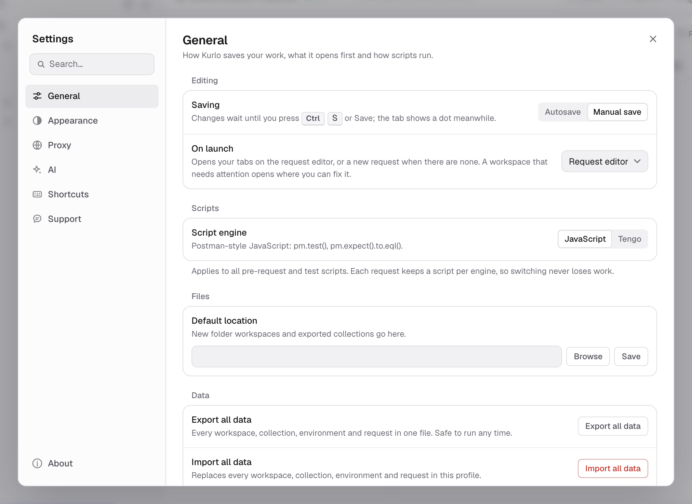
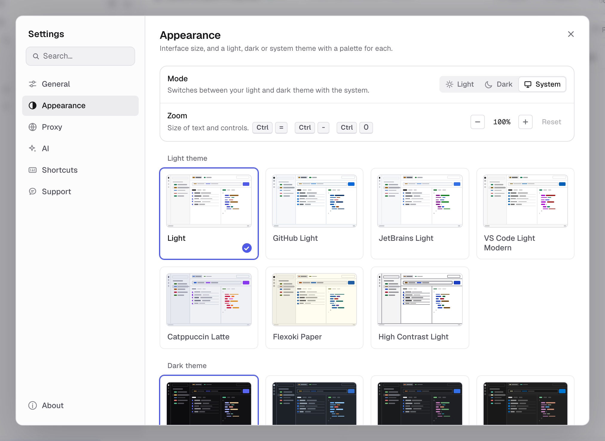
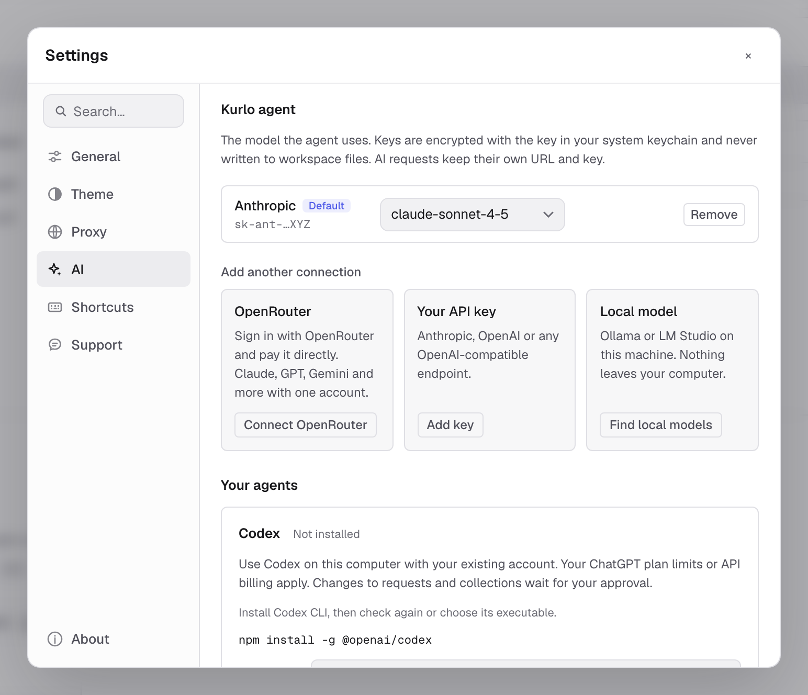
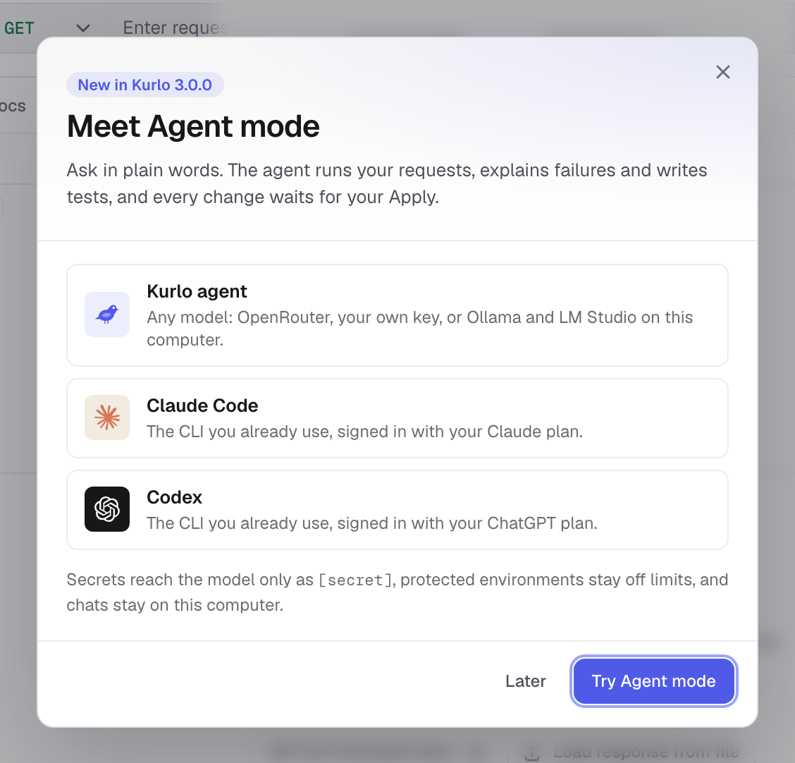

Open app settings from the gear at the bottom of the activity rail — the strip of icons on the far left — or with the **Settings** keyboard shortcut. Every page has the same layout: a title and a line on what it covers, then settings grouped in boxes, each row with its name and description on the left and its control on the right. The search field filters the settings navigation and the groups shown on the General page.

App settings are different from the settings attached to API data:

| Scope | Where to edit | What it affects |
|-------|---------------|-----------------|
| App | Activity rail -> gear | Kurlo on this device: saving mode, theme and zoom, global proxy, shortcuts, updates, and local preferences. |
| Collection | Collection menu -> Settings | Defaults applied to requests in that collection. |
| Request | Open request -> Settings tab | Transport and protocol behavior for one request. |

See [Collection defaults](/docs/guides/collection-defaults/) and [Per-request settings](/docs/guides/request-settings/) for the other two scopes.

## General

### Saving

Under **Editing**, the **Saving** row switches between two modes:

- **Autosave** saves request and collection edits automatically.
- **Manual save** keeps edits dirty until you click **Save** or use the save shortcut. A dot on the request tab marks unsaved work.

In manual-save mode, an all-data export contains the last saved version of each request, not unsaved editor changes. Kurlo warns you before exporting when dirty requests exist.

### On launch

The **On launch** list chooses the screen Kurlo opens on; the row describes the current choice:

| Option | What you see |
|--------|--------------|
| **Request editor** *(default)* | Your open tabs on the request editor. With no requests yet, a new unsaved HTTP request. |
| **Where you left off** | The last screen of the previous session — Git, the runner, a collection, an environment or the overview. |
| **Workspace overview** | Collections, recent history and storage for the active workspace. |

Your open tabs come back in every mode; only the screen in front changes. A workspace that needs attention, such as a missing folder or broken YAML, opens where you can fix it whatever this is set to.

### Script engine

Under **Scripts**, choose **JavaScript** for Postman-style scripts or **Tengo** for the legacy lightweight engine. The selection controls which script fields Kurlo displays and runs.

Each request and collection keeps separate JavaScript and Tengo source. Switching engines does not delete the script stored for the other engine.

Imports from Postman, Insomnia, Bruno and other tools put their scripts in the JavaScript fields, and exports to those formats take the JavaScript scripts, whichever engine is selected. Tengo scripts stay in Kurlo.

See [Scripting](/docs/guides/scripting/) for runtime behavior and examples.

### Default location

Under **Files**, type a path or click **Browse**; Kurlo saves it when you leave the field, press `Enter` or click **Save**. The default location is the starting directory for:

- New folder-backed workspaces.
- Collection exports that ask for a destination folder.

Changing it does not move existing workspaces or repositories.

### Data

**Export all data** creates a Kurlo-to-Kurlo JSON backup. **Import all data** replaces the current local profile after confirmation.

Read [Backup & recovery](/docs/guides/backup-recovery/) before using the import action.

## Appearance

The **Mode** row chooses **Light**, **Dark**, or **System**, then select separate light and dark variants. Each variant is shown as a miniature of Kurlo in its own colours — sidebar, request bar, a table and a highlighted response — so you can compare them before switching. System mode follows the operating-system appearance and uses the matching selected variant.

Theme preferences apply only to Kurlo's UI; they do not change generated code, request headers, or response rendering.

The **Zoom** row makes the whole interface larger or smaller: **−** and **+** step from 80% to 150% and **Reset** returns to 100%. The same steps are on `Cmd/Ctrl =`, `Cmd/Ctrl -` and `Cmd/Ctrl 0`, in the command palette as **Zoom in**, **Zoom out** and **Reset zoom**, and on macOS in the **View** menu. The size is stored on this device.

On Windows and Linux Kurlo draws its own title bar: drag the top bar to move the window, double-click it to maximize, and use the buttons on the right to minimize, maximize or close. On Linux `Ctrl Q` quits.

## Proxy

The Proxy page configures the fallback used across requests on this device. Request and collection proxy URLs can override it. Choose **Off**, **On** or **System** in the first row; with **On**, the **Server** group (protocol, address and port, bypass list) and the **Authentication** group appear below.

See [Proxy configuration](/docs/guides/proxy/) for precedence, authentication, bypass rules, and the difference between Off, On, and System modes.

## AI

The AI page has three groups. **Your agents** connects an installed Codex CLI using its own account: its row shows the connection state, the signed-in account and CLI version, the model (changing it saves at once) and **Remove connection**; once connected, bars show how much of the plan's 5-hour and weekly limits is left and when each resets. **Executable** below opens the path to the CLI with **Check again** and **Choose executable**; see [Local agents](/docs/guides/agent/#local-agents). **Kurlo agent** lists the model connections used by the built-in agent and AI requests, and **Add another connection** offers the three ways to add one.

The AI tab keeps the models that Kurlo's own AI features use. AI requests are separate: each one keeps its own base URL and key, so it can point at any provider or gateway you are testing.

There are three ways to connect a model:

- **OpenRouter.** Click **Connect OpenRouter**. Kurlo opens openrouter.ai in your browser, where Kurlo asks for a key labelled `Kurlo`. After you approve, the browser passes through kurlo.dev back to the Kurlo app on a one-time local address, and the key is saved. You pay OpenRouter directly and can use Claude, GPT, Gemini and other models with one account. Click **Reopen browser** if you closed the tab, or **Cancel** to stop. The sign-in expires after five minutes.
- **Your API key.** Click **Add key**, choose Anthropic, OpenAI or OpenAI-compatible (enter its base URL, such as `https://llm.example.com/v1`), and paste the key. **Test** checks the key and loads the provider's models; choose one and click **Save**.
- **Local model.** Click **Find local models**. Kurlo looks for Ollama on port 11434 and LM Studio on port 1234 on this machine and lists their models. For another OpenAI-compatible server, enter its URL and click **Check**. Nothing leaves your computer.

Model lists open with a search field: type part of a name, use the arrow keys and press `Enter`. **Recommended** marks models that handle tool calls well, and **No tools** marks models whose provider reports no tool support.

Kurlo keeps up to ten connections. The first one becomes the default; **Make default** changes it. The model next to a connection opens its model list, and **Remove** (click twice) deletes the connection and its key. An AI request whose provider is **Kurlo connection** uses the default connection, and the [agent](/docs/guides/agent/) starts new chats with it.

Keys are encrypted with the same key as the local profile, which Kurlo keeps in the system keychain, and are stored in `preferences.json`. They are never written to workspace YAML or shown in the interface: a connection shows only a hint such as `sk-ant-…XYZ`, and when a provider repeats the key in an error, Kurlo shows `[your key]` instead. Checking a key and listing models use the system proxy environment variables, not the proxy configured in Kurlo.

## Shortcuts

Shortcuts are grouped by area. Click a combination and press the new one; the line under the title says what Kurlo is waiting for. Individual shortcuts and the complete set can be reset to their defaults.

The current command list and default bindings are documented in [Keyboard shortcuts](/docs/reference/keyboard-shortcuts/).

## Updates

Updates live in the **About** tab, under the version. The first row shows the current state and one action: **Check for updates**, **Install**, **Restart now**, or **Try again** after an error. When a new release is found, its notes appear below the list.

When the background check finds a release, a notice in the lower-right corner says so; **View** opens the **About** tab.

**Install updates automatically** installs a discovered release in the background, then asks you to restart. Development builds created with `make dev` or `go run` do not use the release updater, so both controls are off there.

## What's new

The first time Kurlo starts after updating to a new version, it opens a **What's new** screen with that release's notes. It appears once per version: relaunching the same build, downgrading, and a first-ever install all stay quiet — a brand-new user has nothing to catch up on.

The first launch after updating from a 2.x version to 3.0 or later shows **Meet Agent mode** instead: the three agents you can use, with **Try Agent mode** to open the [Agent](/docs/guides/agent/) tab and **All changes** for the release notes. **Later** closes it, and it does not come back.

You can reopen it any time from **About → What's new**. The notes are bundled with the build, so the screen works offline and always describes the version you are actually running.

## Support and About

**Support** opens Kurlo's public issue tracker for bugs and questions, copies a diagnostics summary (version, platform, Git and storage state) to paste into an issue, and opens the folder holding `kurlo.log`. **About** shows the installed Kurlo version and platform; include both when reporting a problem.

For common failures, start with [Troubleshooting](/docs/troubleshooting/).
