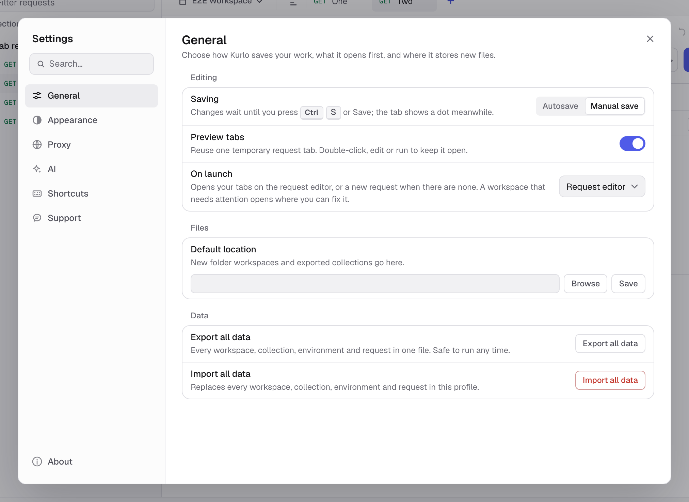

import DocsTopicIndex from "../../../../components/DocsTopicIndex.astro";

Open app settings from the gear at the bottom of the activity rail — the strip of icons on the far left — or with the **Settings** keyboard shortcut. Every page has the same layout: a title and a line on what it covers, then settings grouped in boxes, each row with its name and description on the left and its control on the right. The search field filters the settings navigation and the groups shown on the General page.

<DocsTopicIndex />

App settings are different from the settings attached to API data:

| Scope | Where to edit | What it affects |
|-------|---------------|-----------------|
| App | Activity rail -> gear | Kurlo on this device: saving mode, theme and zoom, global proxy, shortcuts, updates, and local preferences. |
| Collection | Collection menu -> Settings | Defaults applied to requests in that collection. |
| Request | Open request -> Settings tab | Transport and protocol behavior for one request. |

See [Collection defaults](/docs/guides/collection-defaults/) and [Per-request settings](/docs/guides/request-settings/) for the other two scopes.
