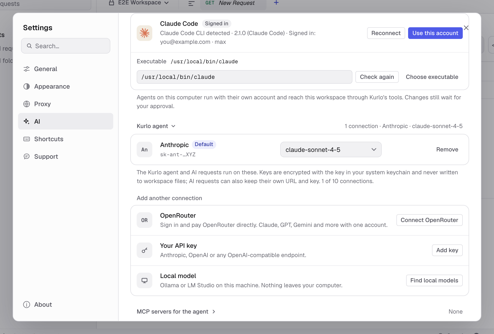

## AI

**Your agents** connects installed Codex and Claude Code CLIs using their own accounts. Each shows connection status, CLI version, model selection, and executable controls. Codex also shows reported plan limits when available. See [Local agents](/docs/guides/agent/local-agents/) for sign-in and setup.

**Kurlo agent** lists the model connections used by the built-in agent. An [AI request](/docs/guides/request-types/ai/#ai) can use a Kurlo connection or its own provider URL and credentials.

There are three ways to connect a model:

- **OpenRouter.** Click **Connect OpenRouter**. Kurlo opens openrouter.ai in your browser, where Kurlo asks for a key labelled `Kurlo`. After you approve, the browser passes through kurlo.dev back to the Kurlo app on a one-time local address, and the key is saved. You pay OpenRouter directly and can use Claude, GPT, Gemini and other models with one account. Click **Reopen browser** if you closed the tab, or **Cancel** to stop. The sign-in expires after five minutes.
- **Your API key.** Click **Add key**, choose Anthropic, OpenAI or OpenAI-compatible (enter its base URL, such as `https://llm.example.com/v1`), and paste the key. **Test** checks the key and loads the provider's models; choose one and click **Save**.
- **Local model.** Click **Find local models**. Kurlo looks for Ollama on port 11434 and LM Studio on port 1234 on this machine and lists their models. For another OpenAI-compatible server, enter its URL and click **Check**. Nothing leaves your computer.

Model lists open with a search field: type part of a name, use the arrow keys and press `Enter`. **Recommended** marks models that handle tool calls well, and **No tools** marks models whose provider reports no tool support.

Kurlo keeps up to ten connections. The first one becomes the default; **Make default** changes it. The model next to a connection opens its model list, and **Remove** (click twice) deletes the connection and its key. An AI request whose provider is **Kurlo connection** uses the default connection, and the [agent](/docs/guides/agent/) starts new chats with it.

Keys are encrypted with the same key as the local profile, which Kurlo keeps in the system keychain, and are stored in `preferences.json`. They are never written to workspace YAML or shown in the interface: a connection shows only a hint such as `sk-ant-…XYZ`, and when a provider repeats the key in an error, Kurlo shows `[your key]` instead. Checking a key and listing models use the system proxy environment variables, not the proxy configured in Kurlo.
