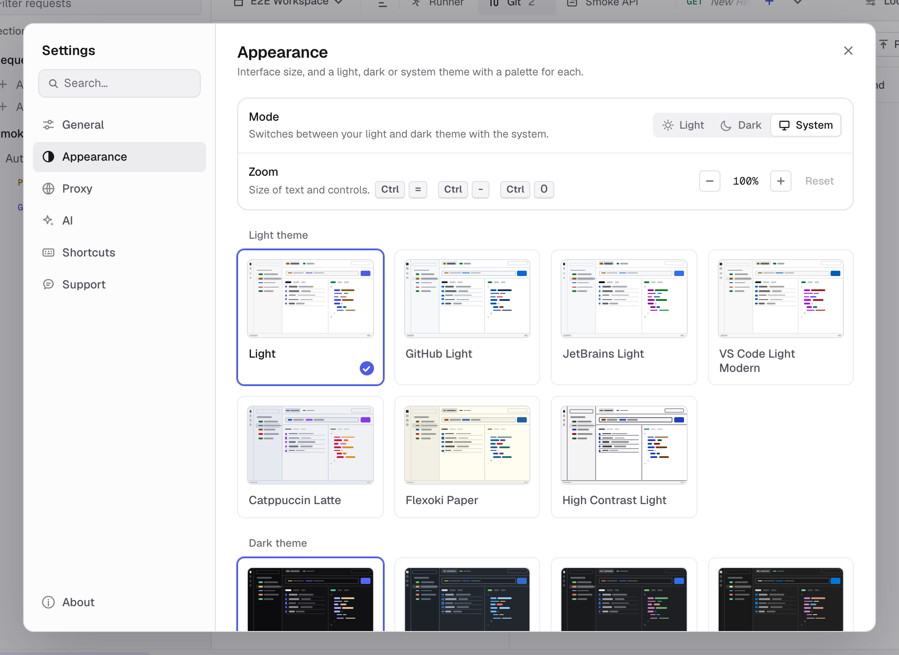

The **Mode** row chooses **Light**, **Dark**, or **System**, then select separate light and dark variants. Each variant is shown as a miniature of Kurlo in its own colours — sidebar, request bar, a table and a highlighted response — so you can compare them before switching. System mode follows the operating-system appearance and uses the matching selected variant.

| Mode | Variants |
|------|----------|
| Light | Light, GitHub Light, JetBrains Light, VS Code Light Modern, Catppuccin Latte, Flexoki Paper, High Contrast Light |
| Dark | Dark, GitHub Dark Dimmed, JetBrains Dark, VS Code Dark Modern, One Dark, Tokyo Night, Catppuccin Mocha, Nord, Everforest, High Contrast Dark |

Every variant keeps text, method labels and status colours at a contrast ratio of at least 4.5:1; the two High Contrast variants raise text to 7:1 and draw stronger borders. Light Monochrome, Light Pastel, Dark Monochrome, Dark Pastel, Catppuccin Frappé and Catppuccin Macchiato were removed in favour of these: a saved choice moves to Light, Flexoki Paper, Dark, Everforest or Catppuccin Mocha.

Theme preferences apply only to Kurlo's UI; they do not change generated code, request headers, or response rendering.

The **Zoom** row makes the whole interface larger or smaller: **−** and **+** step from 80% to 150% and **Reset** returns to 100%. The same steps are on `Cmd/Ctrl =`, `Cmd/Ctrl -` and `Cmd/Ctrl 0`, in the command palette as **Zoom in**, **Zoom out** and **Reset zoom**, and on macOS in the **View** menu. The size is stored on this device.

On Windows and Linux Kurlo draws its own title bar: drag the top bar to move the window, double-click it to maximize, and use the buttons on the right to minimize, maximize or close. The empty spot between the request tabs and the environment switcher always stays free to grab, however many tabs are open: the tabs scroll instead of filling it. On Linux `Ctrl Q` quits.
