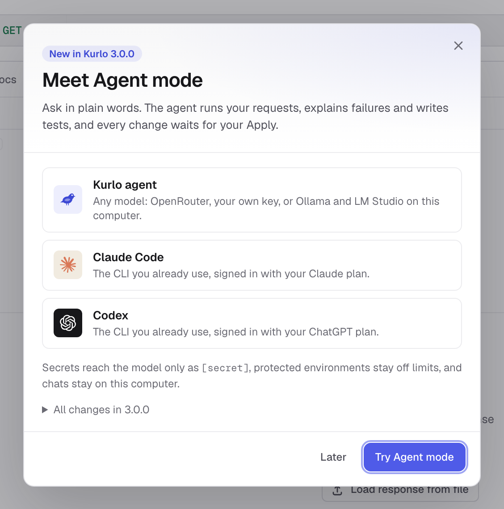

## Updates

Updates live in the **About** tab, under the version. The first row shows the current state and one action: **Check for updates**, **Check again**, **Install** or **Download**, **Restart now**, or **Try again** after an error. When a new release is found, its notes appear below the list.

When the background check finds a release, a notice in the lower-right corner says so; **View** opens the **About** tab.

**Install updates automatically** installs a discovered release in the background, then asks you to restart. Development builds created with `make dev` or `go run` do not use the release updater, so both controls are off there.

For a Windows MSIX installation, download and open the next `.msix` package to upgrade in place. The package directory is managed by Windows.

## What's new

The first time Kurlo starts after updating to a new version, it opens a **What's new** screen with that release's notes. It appears once per version: relaunching the same build, downgrading, and a first-ever install all stay quiet — a brand-new user has nothing to catch up on.

The first launch after updating from a 2.x version to 3.0 or later shows **Meet Agent mode** instead: the three agents you can use, with **Try Agent mode** to open the [Agent](/docs/guides/agent/) tab and **All changes** for the release notes. **Later** closes it, and it does not come back.

You can reopen it any time from **About → What's new**. The notes are bundled with the build, so the screen works offline and always describes the version you are actually running.

## Support and About

**Support** links to the GitHub repository and to [Kurlo on Boosty](/docs/support/), opens Kurlo's public issue tracker for bugs and questions, copies a diagnostics summary (version, platform, Git and storage state) to paste into an issue, and opens the folder holding `kurlo.log`. **About** shows the installed Kurlo version and platform; include both when reporting a problem.

For common failures, start with [Troubleshooting](/docs/troubleshooting/).
