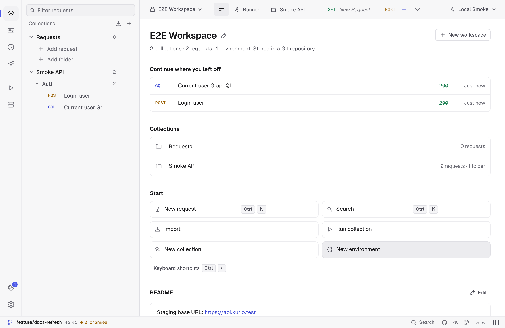

import DocsTopicIndex from "../../../../components/DocsTopicIndex.astro";

<DocsTopicIndex />

Kurlo arranges your requests in a workspace -> collection -> folder tree:

```
Workspace
└─ Collection
   ├─ Folder
   │  ├─ Subfolder
   │  │  └─ Request
   │  └─ Request
   └─ Request
```

Use **workspaces** to separate unrelated work (personal · day-job · client X), **collections** to group requests by API or domain (`Stripe v2024` · `internal billing`), and **folders/subfolders** to slice a large collection by feature, version, or test scenario.


