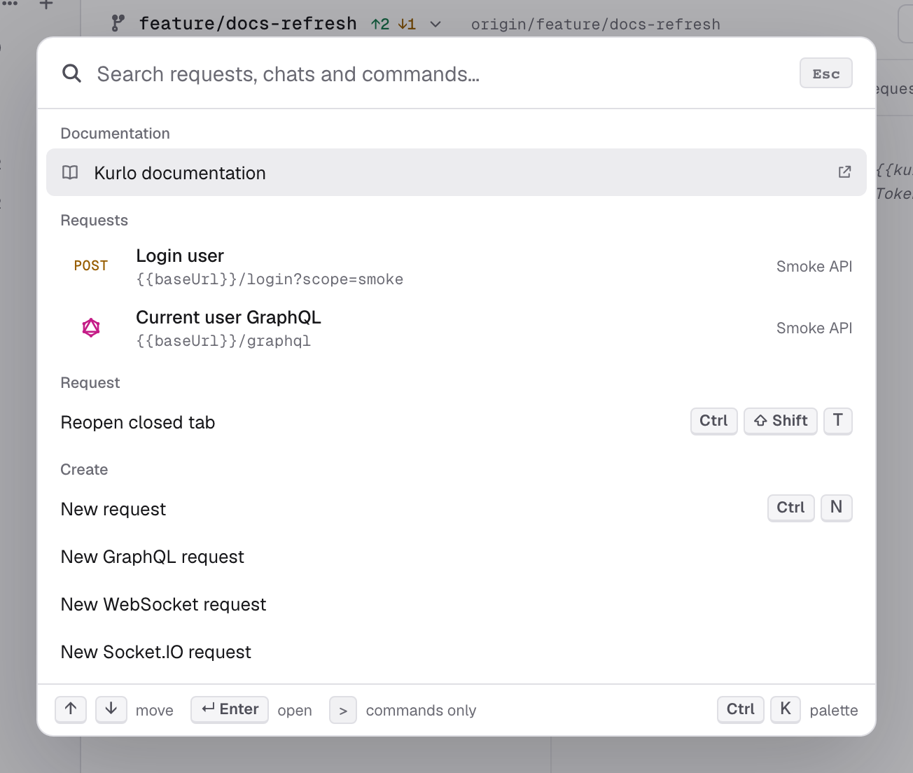
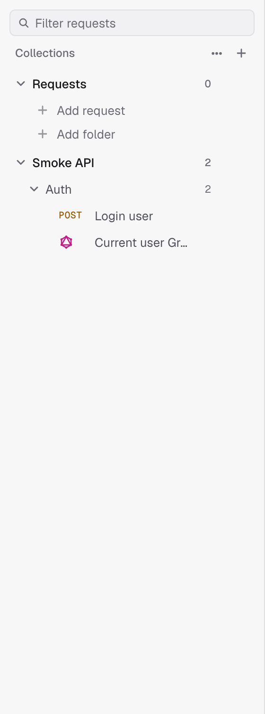

Press `Cmd/Ctrl K` — or click **Search** at the bottom right of the window — to open the command palette. Type to find saved requests or Agent chats in the current workspace. Request search matches names, URLs, methods, collections, and folders. The same query filters Kurlo's commands.

- **Request** — send, save, edit the URL, duplicate, rename, copy as cURL, close or reopen a tab. Shown while a request is open.
- **Create** — a new request, collection or environment, or an import.
- **Go to** — collections, environments, history, globals, the collection runner, the mock server, Git, cookies, settings and proxy settings.
- **View** — show or hide the sidebar and the code snippet panel, put the response beside or below the request, switch between light, dark and system theme.
- **Help** — what's new, reporting an issue, about Kurlo.

The response layout also has a button in the status bar, next to the sidebar toggle. Kurlo puts the response beside the request on its own when the editor is at least 1000 px wide; once you choose the side-by-side layout yourself, it keeps it down to 760 px. Dragging the divider stops before either side gets too narrow to use.

**Kurlo documentation** sits at the top of the empty palette and opens the docs in your browser. Once you type, the last row becomes **Search Kurlo docs for “…”** and opens the docs with that search already run, so `Enter` still picks the best request or command.

Start the query with `>` to list commands only; the docs row is hidden then. `↑` and `↓` move through the list, `Enter` runs the selection, `Esc` closes the palette. A command bound to a shortcut shows it, including one you reassigned in *Settings → Shortcuts*.

## Empty states

When something is empty, Kurlo shows a hint so you're never staring at blank space:

- **No collections yet** — sidebar onboarding with *New collection* / *Import collection* buttons
- **Empty collection** — inline *+ Add request* / *+ Add folder* rows inside the collection
- **Empty folder** — same pattern, nested one level deeper

Once an item is added, the hint disappears.

## Git storage

If the workspace is backed by a folder or Git repository, collections and folders are written to YAML files with explicit `folderPaths`, so empty folders survive round-trips through Git and OpenCollection export. See [Git-backed workspaces](/docs/guides/git-workspaces/) for the full workflow.
