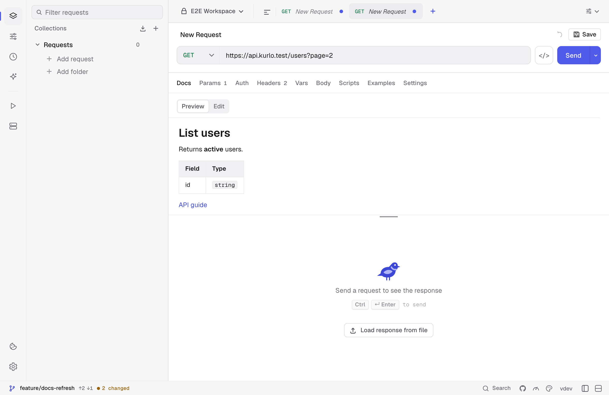

## Requests

A request is the leaf of the tree. Each request has its own URL, method, headers, body, auth config, pre-request and test scripts, settings, and notes.

### Creating a request

- Collection or folder `⋯` menu → **Add request**
- Workspace overview → *Start* → **New request**
- Drafts: **+** after the open tabs opens an unsaved HTTP request. Untitled drafts are numbered, such as **New Request 2**, and a draft gets a dot on its tab once you change it; an untouched draft closes without asking. Use the method and protocol picker at the start of the URL bar to switch request types before saving.

With manual saving, a request added from a collection or folder starts as a draft too. It already uses the headers, auth, scripts and variables of that collection and folder, and **Save** puts it there without asking where. With autosave on, it is saved straight away.

Closing a draft asks whether to save it only when you have changed it since it opened. An untouched draft, like an empty tab from **+**, closes without asking.

### Tab menu

Right-click a request tab to close it, close the other tabs, close the tabs to its right or close all tabs. Tabs with unsaved changes still ask before closing. The same menu duplicates the request, copies its URL or a cURL command, and shows its file in Finder or File Explorer.

### Encoding selected text

Select text in the URL, a param, a header or another field and right-click it to **Encode URI component**, **Decode URI component**, **Encode Base64** or **Decode Base64**. Kurlo replaces the selection and keeps the result selected, so you can undo it with `⌘Z` or `Ctrl+Z`. Base64 decoding also reads the URL-safe alphabet used in JWTs. Actions that would not change the text, or cannot decode it, are dimmed.

### Docs

The **Docs** tab of a request is written in Markdown: headings, **bold**, `code`, lists, task lists, tables, quotes, links and images. **Edit** shows the text on the left and a live preview on the right; **Preview** shows the rendered page, followed by a reference Kurlo builds from the request itself: the method and URL, the auth type, and the enabled path variables, query params, headers and body, with the description you gave each row. Links open in your browser, and secret values are masked. A request without docs opens in **Edit**; `Esc` goes back to the preview.

### The request `⋯` menu

Right-click (or click the `⋯` button on hover) on any request to reveal:

- **Rename** — inline rename; double-click the title also works
- **Duplicate** — clones the request, including auth/headers/body/scripts
- **Star** / **Unstar** — adds the request to the *Starred* group at the top of the sidebar, or removes it.
- **Copy as cURL** — copies a `curl` command for a supported request. Review the command before sharing it.
- **Show in Finder** / **Show in Explorer** — opens the folder that holds the request's YAML file with the file selected. On Linux it is **Show in file manager**: file managers that support it, such as Files (Nautilus), Dolphin, Thunar, Nemo and Caja, select the file too, and others open its folder. Unsaved drafts have no file yet, so they do not offer it.
- **Delete** — asks for confirmation before removing the request. You can restore it from **Recently deleted** until you quit Kurlo.

### Reordering requests

Hover a request to reveal its `⋮⋮` handle on the left. Drag it onto another request in the same collection or folder: the top half places it above, and the bottom half places it below. A line shows the insertion point. The order is saved in `collection.yml` and persists between sessions.

To move a saved request, drop it onto a folder header or an empty folder in the same collection. Nested and collapsed folders accept drops too. Drop onto the collection header to move it back to the root. Empty source folders are kept.

Clear the sidebar search before dragging. Dragging onto another request changes the order among siblings; dragging onto a folder changes the parent.
