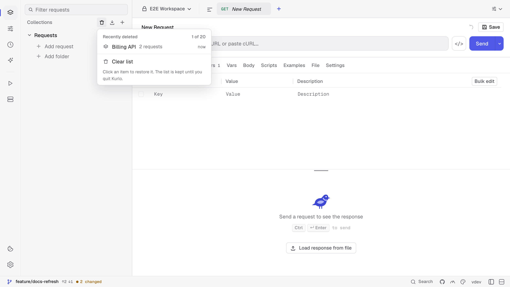

## Starred (favourites)

Use **Star** to mark requests you reach for often. Starred requests appear in their own group at the top of the sidebar, **above all collections**, regardless of which collection they live in. Unstar from the same menu to remove them from the favourites group (the request itself stays in its collection).

The Starred group only appears when at least one request is starred. It shows up to ten requests and scrolls within that space, so the collections below stay in view however many requests you star. Click the *Starred* header to collapse the group; Kurlo remembers that across restarts.

Stars are personal. They are kept in your local workspace data, not in the request files, so they are not committed to Git and teammates do not see them. Stars saved in request files by Kurlo 3.0.4 and earlier are picked up the first time you open the workspace, and the old `isPinned` field is removed from each file the next time it is saved.

## Restoring deleted items

Deleting a request, folder, collection or environment shows a message with **Undo** for a few seconds. Undo puts it back where it was, with the same requests, folders, folder defaults, order and AI request chats; a restored environment gets back its child environments and the collections it was pinned to.

After the message is gone, the trash button appears in the **Collections** header (requests, folders and collections) or the **Environments** header (environments). It lists the last 20 deletions of the current workspace, newest first; click one to restore it, or choose **Clear list** to forget them. A request or folder whose collection was deleted too can be restored once the collection is back.

The list lives only while Kurlo is open: after you quit, deleted items are gone from Kurlo. In a [Git workspace](/docs/guides/git-workspaces/) you can still get the files back from Git until you commit the deletion. Deleting a workspace is not covered.
