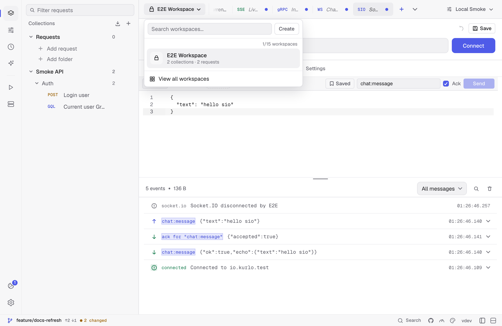

## Workspaces

A workspace groups its collections, environments, and cookie jar. [Request history](/docs/guides/history/) is stored across workspaces in the current profile.

### Creating a workspace

Open the **Workspace switcher** and click **Create**, or click **New workspace** on the workspace overview. To rename a workspace, click its name at the top of the overview. **Enter** saves the new name and **Esc** cancels.

On macOS the workspace name sits above the sidebar, at its right edge. When you hide the sidebar it moves to the start of the top bar.

### Switching workspaces

The same dropdown shows all workspaces with their request counts. Switching is instant — Kurlo keeps each workspace's open tabs, active environment, and last-viewed request restored separately.

### Workspace overview

If no request is open, the workspace overview is shown. Under the workspace name — with how many collections, requests and environments it holds, and whether it lives in a Git repository — it lists:

- **Continue where you left off** — the last requests you sent from this workspace, newest first, with the status each one got. Click one to open it. Point at an HTTP, GraphQL or gRPC request to get a **Send** button that opens it and sends it again in one click. Requests you have since deleted are left out.
- **Collections** — every collection with its request and folder count. Click one to open its settings.
- **Start** — tiles for new request, search, import, run a collection, new collection and new environment, with the shortcut shown where there is one, and a link to the keyboard shortcuts.
- **README** — Markdown notes for whoever opens the workspace next: base URLs, auth hints, which environment is safe to break, links. It shows rendered, with each line where you typed it; **Edit** switches to the text and **Done** or **Esc** back. With manual save, the README stays unsaved until you click **Save**; the round arrow (**Revert**) next to it throws the edits away, and **Done** leaves the editor without saving. Kurlo keeps it as `README.md` in the workspace folder, so a Git host shows it when you browse that folder (there, lines without an empty line between them join into one paragraph), and changes made to that file outside Kurlo show up here. A long README is folded to its first screen with **Show all** under it. A `README.md` that is over 256 KB, is not UTF-8 text, or is a link to another file shows as read-only with the reason, and Kurlo never changes or deletes it.

A workspace with nothing in it yet shows a short first-run panel instead: start a new request (paste a URL or a whole cURL command) or import a collection from Postman, Insomnia, OpenAPI, Bruno / OpenCollection or HAR.
