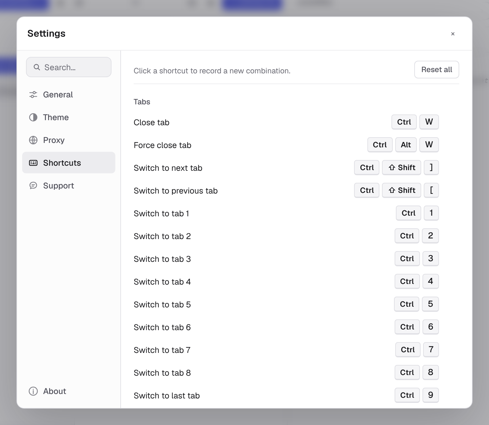

On macOS Kurlo displays `Cmd` shortcuts with `⌘`. On Windows and Linux the same defaults display and run as `Ctrl`, with modifiers in the usual `Ctrl` → `Alt` → `Shift` order. Shortcuts follow the physical key, so they keep working on a Cyrillic, Greek or any other non-Latin layout.

Every shortcut is rebindable from **Settings → Shortcuts**. Click any shortcut chip, press the new combo, done. Reset all to factory defaults with the *Reset all* button.

## Global

| Shortcut | Action |
|----------|--------|
| `Cmd/Ctrl K` | Command palette — search saved requests and run commands |
| `Cmd/Ctrl ,` | Open settings |
| `Cmd/Ctrl Backslash` | Toggle sidebar |
| `Alt Cmd/Ctrl Backslash` | Toggle right sidebar / code snippet panel |
| `Cmd/Ctrl =` | Zoom in — make the whole interface larger |
| `Cmd/Ctrl -` | Zoom out |
| `Cmd/Ctrl 0` | Reset zoom to 100% |
| `Cmd/Ctrl /` | Open shortcut help |
| `Alt Cmd/Ctrl V` | Put the response beside or below the request |
| `Alt Cmd/Ctrl 1` | Show collections in the sidebar |
| `Alt Cmd/Ctrl 2` | Show environments in the sidebar |
| `Alt Cmd/Ctrl 3` | Show history in the sidebar |
| `Alt Cmd/Ctrl E` | Choose the environment |
| `Shift Cmd/Ctrl N` | New collection |
| `Cmd/Ctrl O` | Import a collection |
| `Shift Cmd/Ctrl R` | Open the collection runner for the current collection |

## Requests

| Shortcut | Action |
|----------|--------|
| `Cmd/Ctrl N` | New HTTP request |
| `Cmd/Ctrl L` | Focus the request URL |
| `Cmd/Ctrl W` | Close current tab |
| `Alt Cmd/Ctrl W` | Force close current tab |
| `Alt Shift Cmd/Ctrl W` | Close the other tabs |
| `Shift Cmd/Ctrl W` | Close all tabs |
| `Shift Cmd/Ctrl T` | Reopen last closed tab |
| `Cmd/Ctrl Enter` | Send request |
| `Escape` | Cancel the request that is running |
| `Cmd/Ctrl S` | Save request |
| `Shift Cmd/Ctrl C` | Copy the request as cURL |
| `Shift Cmd/Ctrl F` | Find and replace in the request's collection or folder |
| `Cmd/Ctrl 1` … `Cmd/Ctrl 8` | Switch to tab 1–8 |
| `Cmd/Ctrl 9` | Switch to the last tab, whichever number it is |
| `Shift Cmd/Ctrl [` / `Shift Cmd/Ctrl ]` | Previous / next tab |

`Escape` cancels only while the open request is running; otherwise it closes menus as before. Closing several tabs asks about unsaved changes and drafts one tab at a time, and stops if you cancel.

The `Alt` shortcuts other than the tab ones leave text fields alone, so `AltGr` combinations still type characters such as `€` there.

Two more work without a binding and cannot be remapped: `Enter` in the URL field sends the request — or connects a WebSocket, Socket.IO or SSE request — and a middle click on a tab closes it.

## Sidebar

| Shortcut | Action |
|----------|--------|
| `Cmd/Ctrl F` | Search sidebar |
| `↑` / `↓` | Previous / next sidebar item |
| `→` / `←` | Expand / collapse selected item |
| `Alt →` / `Alt ←` | Expand all / collapse all |
| `Cmd/Ctrl E` | Rename selected item |
| `Cmd/Ctrl D` | Duplicate selected item |
| `Cmd/Ctrl C` / `Cmd/Ctrl V` | Copy / paste selected item |
| `Backspace` | Delete selected item |

The arrow keys and `Backspace` leave the sidebar alone while a text field, the response body, a dialog, a menu or a tab bar has focus — there they scroll, edit or move between choices instead.

## Remapping

**Settings → Shortcuts** lists every action with its current binding. Click a shortcut, press the desired key combination, and the new binding is saved immediately. Assigning an existing combination unassigns it from the previous action. **Reset all** restores the default table. On Windows a binding can use the Windows key, and on Linux the Super key; they show as their own keys rather than as `Ctrl`.

The send shortcut also sends the message from the WebSocket, Socket.IO and gRPC message editors, and a rebound send shortcut works there too.
