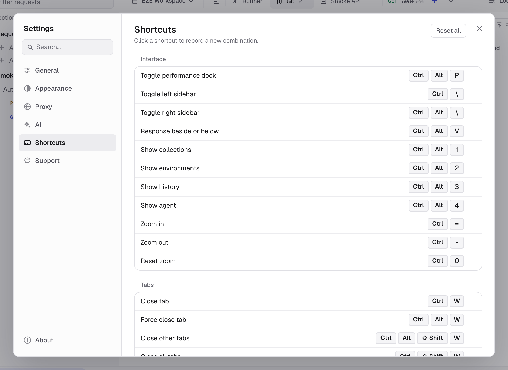

import DocsTopicIndex from "../../../../components/DocsTopicIndex.astro";

On macOS Kurlo displays `Cmd` shortcuts with `⌘`. On Windows and Linux the same defaults display and run as `Ctrl`, with modifiers in the usual `Ctrl` → `Alt` → `Shift` order. Shortcuts follow the physical key, so they keep working on a Cyrillic, Greek or any other non-Latin layout.

To change a binding listed in **Settings → Shortcuts**, click its chip and press the new combination. Use **Reset all** to restore the defaults. The [request editor shortcuts](/docs/reference/keyboard-shortcuts/requests/) also list fixed actions such as sending with `Enter` in the URL field.

Right-click any text field or code editor for **Cut**, **Copy**, **Paste** and **Select all**. The same actions keep their usual `Cmd/Ctrl X`, `C`, `V` and `A` keys, and a read-only editor such as the response body offers only **Copy** and **Select all**.

<DocsTopicIndex />
