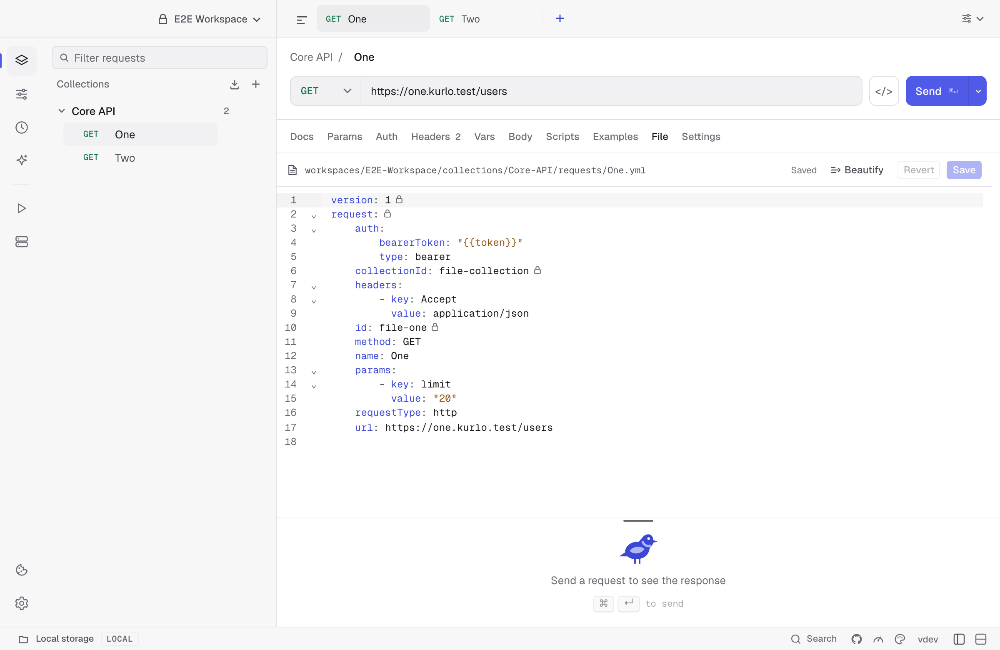

Path: `workspaces/<workspace>/collections/<collection>/requests/<request filesystemName>.yml`

Open a saved request and choose **File** to edit this YAML in Kurlo. For a new draft, choose **Save request** to create the file in a collection first. Long lines wrap to the panel width. Use the arrows beside the line numbers to collapse headers, scripts or other multi-line sections.



The request name, URL, HTTP method and protocol in the address bar edit the same draft. Changes appear immediately in both places. Editing the URL here updates the `url` field. You can edit any separate `params` rows in the YAML. You can also type a gRPC method or choose an AI provider and model from the bar.

Use ⌘F or Ctrl+F inside the editor to find a field. Edit the YAML and choose **Save**, or use the request save shortcut (⌘S on macOS, Ctrl+S on Windows and Linux). File edits use explicit saving even when autosave is on. After a successful save, the request form and subsequent sends use the new values. **Revert** restores the last saved text. If you edit the URL in the address bar and then change it back, only your other edits remain. When the draft matches the saved file, Kurlo shows **Saved**.

You can switch to another request and come back to your edits. When you close the request or return to its form, Kurlo asks how to handle unsaved YAML. If the file changed on disk, review the two versions before saving your edits or loading the disk version.

Kurlo marks managed fields with a lock. Hover over a marked field to see what it controls. The file version, request ID, collection ID, filename, legacy collection name and legacy order are protected when present. Keep these fields intact when pasting YAML from elsewhere. To move a request, use the collection sidebar. Use **Auth** or **Vars** to enter secret values. The YAML uses vault references for those values.

Start typing a key or press Ctrl+Space to list available fields at the cursor. Inside `auth`, choose a `type` first. For example, `type: basic` offers `basicUser` and `basicPass`. With `type: bearer`, it offers `bearerToken`. The editor also suggests allowed values for fields such as `method` and `enabled`. Use the arrow keys and Enter to choose a suggestion, or Escape to dismiss the list.

After a short pause in typing, Kurlo checks the edited request against the workspace schema and underlines the first invalid line. Hover over the underline to read the error. Use unquoted `true` and `false` for boolean fields. **Beautify** (Option+Shift+F on macOS, Alt+Shift+F on Windows and Linux) applies Kurlo’s indentation, key order and quoting style to the draft. Ordinary strings such as `GET` use plain text. Strings that need quotes use double quotes, so a string such as `"false"` keeps its type. Beautify also drops legacy `requestTab`, `enabled: true` and empty descriptions from key-value rows. It keeps disabled rows, comments and list order. You can undo the formatting or save the draft with **Save**.

**Save** applies the same formatting as **Beautify** and preserves the file’s line endings. Opening an older file leaves it untouched. Its first Beautify can show unsaved changes if it uses older quotes or includes fields that Kurlo now omits. After saving, Beautify leaves the file clean. Visual wrapping and folding do not add line breaks to the file.

A simple GET can fit in a few lines.

```yaml
version: 1
request:
  id: req-health
  collectionId: collection-core
  name: Health check
  requestType: http
  url: https://api.example.com/health
```

Kurlo omits empty fields and default settings when it writes a request from the form. Older files with explicit defaults still load. The selected editor section is remembered locally for each request. A legacy `requestTab` supplies the initial selection.

<details>
<summary>Expanded POST example with authentication, a JSON body and explicit defaults</summary>

```yaml
version: 1
request:
  id: req-login
  name: Login
  requestType: http
  collectionId: collection-core
  folderPath:
    - Auth
  method: POST
  url: "{{baseUrl}}/login"
  params: []
  headers:
    - id: 1
      key: Content-Type
      value: application/json
  auth:
    type: bearer
    bearerToken: "{{kurloSecret:request.req-login.auth.bearerToken}}"
    basicUser: ""
    basicPass: ""
    apiKeyName: X-API-Key
    apiKeyValue: ""
    apiKeyIn: header
    oauth2GrantType: client_credentials
    oauth2AuthURL: ""
    oauth2TokenURL: ""
    oauth2ClientID: ""
    oauth2Secret: ""
    oauth2Scope: ""
    oauth2Token: ""
    oauth2RefreshToken: ""
    oauth2TokenExpiry: 0
    oauth2UsePKCE: true
    awsAccessKey: ""
    awsSecretKey: ""
    awsRegion: us-east-1
    awsService: execute-api
  bodyType: json
  rawBodyType: json
  bodyContent: |-
    {"username":"ada"}
  bodyFilePath: ""
  bodyFileName: ""
  formRows: []
  graphqlSchema: ""
  preRequestScriptJs: ""
  testScriptJs: ""
  requestNotes: ""
  settings:
    httpVersion: auto
    enableSSLVerification: true
    followRedirects: true
    followOriginalMethod: false
    followAuthorizationHeader: false
    removeRefererHeader: false
    encodeUrlAutomatically: true
    disableCookieJar: false
    maxRedirects: 10
    timeoutMs: 30000
    proxyUrl: ""
    browserEmulation: false
    browserOrigin: ""
    browserWithCredentials: false
    browserEnforceCORS: false
    browserEnforceCSP: false
    browserCSP: ""
    wsHandshakeTimeoutMs: 0
    wsReconnectAttempts: 0
    wsReconnectIntervalMs: 5000
    wsMaxMessageSizeMb: 10
    sioClientVersion: v3
    sioPath: /socket.io
    sioNamespace: /
    grpcUseTls: false
    grpcUseReflection: true
    grpcServerName: ""
    grpcIncludeDefaultValues: true
    grpcMaxResponseMessageSizeMb: 10
  settingsOverrides: {}
  grpcMethod: ""
  grpcMetadata: []
  grpcUseReflection: true
  grpcProtoFilePath: ""
  grpcProtoFileName: ""
  grpcProtoImportPaths: []
```

</details>
