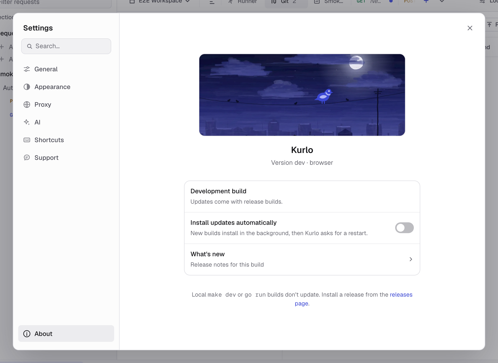

## "No compatible update package is available for this device yet"

This error means the auto-updater couldn't find a binary for your platform in the latest release. Either:

- A new platform was added in the latest release and your old build doesn't know about it (unlikely),
- Or the release was partial — e.g. the maintainer published a macOS-only patch release. Wait for the next full release.

## Updates aren't available in development builds

If you're running a `make dev` / `go run` build, Settings → About says *Development build* and explains why, instead of offering a check. This is intentional — there's no released version newer than your local source tree. Install a release build to receive updates.

## "The downloaded update could not be verified"

The downloaded binary's SHA-256 or minisign signature didn't match what `latest.json` claimed. Causes:

- Network interruption during download — try again.
- Antivirus modified the binary in transit — temporarily allowlist the Kurlo update cache.
- Compromised release channel — file a security issue immediately ([SECURITY.md](https://github.com/stormhop/kurlo/blob/main/SECURITY.md)).

## Linux: "Kurlo cannot replace its AppImage file in this folder"

Kurlo updates an AppImage by replacing the `.AppImage` file it was started from, and the folder that holds it is read-only for your user, for example `/opt`. Move the AppImage to a folder you own, such as `~/Applications`, and install the update again. AppImages from Kurlo 2.2.3 and earlier cannot update themselves at all: download 2.2.4 or later from the [download page](/download/) once.

## Update applied but Kurlo didn't restart

Click *Restart now* in Settings → About. If that doesn't work, quit Kurlo manually and reopen it — the new binary is already in place.
