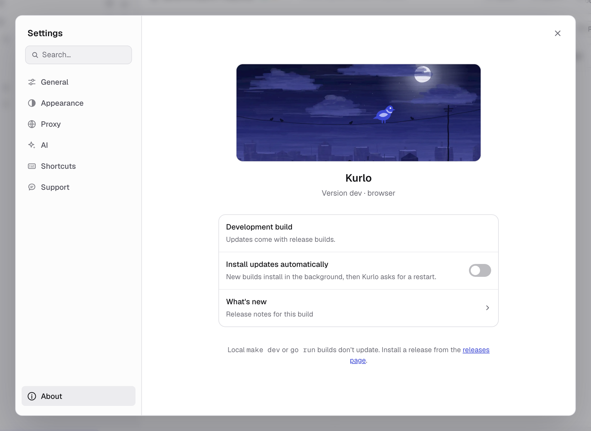

Kurlo is a local-first desktop application. There is no Kurlo backend, account system, cloud sync, usage analytics, crash reporting, or telemetry. Network access occurs only for product features that require it, such as requests, Git operations, OAuth flows, schema introspection, and update checks.

This page documents exactly what data Kurlo stores, where, how it's protected, and the few cases where the app talks to a network on your behalf.

None of it has to be taken on trust: Kurlo is open source under the MIT license, so every claim below can be checked against the code at [stormhop/kurlo](https://github.com/stormhop/kurlo), and the binaries can be reproduced from that source.

## What Kurlo stores on your machine

Workspace state, requests, environments, request history, cookies, secrets, and preferences are written to local disk. Request history records what was sent and what came back, including the response body, which is stored in its own file under `history/` and encrypted with the same key as the rest of the local profile. A response over 2 MB keeps only its head, and a binary response keeps no body at all. Kurlo is a single-tenant, file-based application:

| Platform | Location |
|----------|----------|
| macOS    | `~/Library/Application Support/Kurlo/` |
| Windows  | `%AppData%\Kurlo\` |
| Linux    | `~/.config/Kurlo/` or `$XDG_CONFIG_HOME/Kurlo/` |

Inside that directory you may find:

- `requests.json` — an AES-256-GCM encrypted JSON envelope containing local profile state, history, workspace cookies, Git-local secret values, and storage metadata.
- `request-store.key` — a base64-encoded recovery copy of the encryption key, written with owner-only `0600` permissions.
- `request-store.key.dpapi` — an additional Windows DPAPI-protected key copy.
- `preferences.json` — the configured default workspace location, cookie sync settings, and [AI connections](/docs/guides/settings/#ai) with their keys encrypted by the request-store key. Other UI preferences are stored by the desktop WebView.
- `workspaces/` — the default folder-backed YAML workspace location.

If you select another workspace folder or Git repository, its shared YAML files live at that selected path. Those files are intentionally human-readable and are not encrypted as a unit.

You can move, back up, or delete this directory at any time. Deleting it returns Kurlo to a clean state on next launch.

## Encryption at rest

The request store is encrypted with **AES-256-GCM**:

- A fresh 256-bit key is generated locally the first time Kurlo starts.
- The key is additionally stored in the OS credential store wherever possible:
  - **macOS** — Keychain (the same store used by Safari / login items)
  - **Windows** — DPAPI (current user; non-exportable to another user account)
  - **Linux** — libsecret via `secret-tool` (GNOME Keyring, KWallet, etc.)
- Kurlo also keeps `request-store.key` as a recovery copy even when the credential-store write succeeds. This avoids losing encrypted data if the credential-store entry disappears.
- The recovery file is owner-readable only, but it is not protected by another secret. Anyone who can read both `requests.json` and `request-store.key` can decrypt the local profile.
- Every encrypted payload uses a unique random nonce. There is no nonce reuse across writes.

For folder/Git workspaces, Kurlo replaces sensitive YAML values with `{{kurloSecret:...}}` placeholders and stores the real values inside the encrypted local profile.

## What leaves your machine

A few bounded categories of network calls happen on your behalf:

1. **Requests you send.** This is the whole point — when you press Send, Kurlo opens a connection to the host you typed in the URL bar. The request is built on your machine and sent directly unless you configured a system, global, or per-request proxy.
2. **Auto-update checks.** On launch (and when you press *Check for updates*), Kurlo fetches `latest.json` from the public release repository (`github.com/stormhop/kurlo`) over HTTPS. Release builds verify the downloaded binary by SHA-256 and minisign signature. No usage data is included in the request.
3. **OAuth 2.0 authorization and token calls.** Kurlo can open the provider's authorization page and call the authorization/token endpoints you configured.
4. **GraphQL schema introspection.** When you load a GraphQL schema URL in the Schema tab, Kurlo sends a standard introspection query to that URL.
5. **Git remotes.** Clone, fetch, pull, push, remote tests, and remote branch actions contact the Git server you configured.
6. **An OpenAPI spec you import from a URL.** *Import collection -> OpenAPI / Swagger from URL* fetches the link you paste, through the same sender your requests use, so it honours your proxy settings and the response cap. Cookies are not attached to it.

7. **AI connections.** When you test an AI connection or load its models, Kurlo calls that provider's model list (and, for OpenRouter, its key check) with your key. Connecting OpenRouter opens openrouter.ai in your browser; after you approve, OpenRouter sends the browser to `kurlo.dev/connect/openrouter/`, a static page that forwards it to Kurlo on `127.0.0.1`, and Kurlo exchanges the code for a key at `openrouter.ai/api/v1/auth/keys`. The code passes through that page's URL but cannot be exchanged without a secret that never leaves Kurlo, and it expires after ten minutes. If kurlo.dev cannot be reached, OpenRouter returns to `localhost` directly. *Find local models* only contacts `127.0.0.1` ports 11434 and 1234. These calls follow the system proxy environment variables, not the proxy configured in Kurlo.

Proxy settings can route these requests through your selected system or custom proxy. There is no separate telemetry channel or first-launch ping.

## Ports Kurlo opens on your machine

Four features bind a local listener. All four are loopback-only (`127.0.0.1`, and `::1` for the OpenRouter sign-in), so nothing on your network can reach them, and none of them is open unless you start it.

| Listener | When it exists | What it serves |
|----------|----------------|----------------|
| OAuth 2.0 redirect | Only while an Authorization Code sign-in is in flight, on an ephemeral port | The single `/callback` that receives the authorization code, then closes |
| OpenRouter sign-in | Only while *Connect OpenRouter* is waiting (at most five minutes), on an ephemeral port | The single `/callback` that receives OpenRouter's code, then closes |
| [Cookie sync](/docs/guides/cookies/#sync-cookies-from-your-browser) bridge | While *Sync Cookies* is on (ports 3199-3203) | Pairing and the WebSocket a paired browser pushes cookies over. Extension origins only; a web page probing the port gets a `403` |
| [Mock server](/docs/guides/mock-server/) | While you have it running, on the port you choose | The saved examples of the collection you pointed it at — status, headers and body as recorded. Any program on your machine that can reach the port can read them, so treat a mock made from real responses accordingly. In a browser, only a page served from this machine is answered; a site on another host gets a `403` |

## Scripting safety

Pre-request and test scripts run in a sandboxed JavaScript VM by default, with a legacy [Tengo](https://github.com/d5/tengo) engine for existing requests:

- Imports, `require`, process access, filesystem access, and direct network sockets are disabled.
- Execution is capped at **2 seconds** per script.
- Scripts have access only to the explicit `pm.*` API (request/response/variables/environment/log). They cannot reach the file system, spawn processes, or open network sockets directly. Any HTTP call goes through the regular request engine.

## Cookies

By default Kurlo maintains a cookie jar across requests, just like a browser. Cookies are stored in encrypted `requests.json`. You can:

- Inspect and edit cookies per domain in the Cookies modal (the icon next to the URL bar).
- Clear all cookies from that modal.
- Disable the cookie jar for an individual request in *Per-request settings*.

Cookies are never transmitted anywhere except in the request to the domain that set them, following standard browser rules.

**Cookie sync** (Cookies modal -> *Sync Cookies*) is off unless you turn it on. When on, Kurlo opens a listener bound to `127.0.0.1` that a browser extension can find and ask to connect to; you approve the request in Kurlo by matching a six-digit code, and only then does Kurlo hand over a token. The extension then holds a WebSocket to that port and pushes cookies for the domains you allowlist there, and only those. The token and the allowlist are stored in `preferences.json`. Cookies travel browser -> Kurlo over loopback only, and a snapshot replaces what the jar held for those domains. *Disconnect it* mints a new token and drops the browser immediately.

## Data export and deletion

- **Export** - *Settings -> General -> Advanced data -> Export all data* writes workspace data, history, cookies, secrets, and selected preferences to a plaintext JSON file you choose. External Git repositories, the global proxy password, and some local UI preferences are not bundled. See [Backup & recovery](/docs/guides/backup-recovery/).
- **Import** — replaces the current profile with a previous export. This is destructive; Kurlo shows a confirmation dialog before running.
- **Delete** — quit Kurlo and remove the directory listed under [What Kurlo stores on your machine](#what-kurlo-stores-on-your-machine).

## Reporting a security issue

If you find a vulnerability, please follow the process in our [security policy](https://github.com/stormhop/kurlo/blob/main/SECURITY.md). Please do not file public GitHub issues for security problems.
